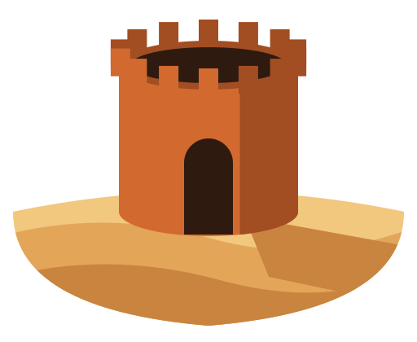

<div align="center">



# Yllir

**Your campaign, written with you. Consistent, linked and saved, just by talking.**

A [Claude Code](https://claude.com/claude-code) plugin for game masters who want a richly detailed tabletop RPG world without managing it by hand.

[Install](#install) · [Your first campaign](#your-first-campaign) · [What you can ask](#what-you-can-ask) · [Your files](#your-campaign-folder) · [Privacy](#privacy-and-what-leaves-your-computer) · [FAQ](#faq)

  

</div>

---

You tell Yllir what you need, in your own words and your own language: *"a port town ruled by a smugglers' guild"*, *"prepare next session"*, *"tonight they burned the warehouse"*. Yllir writes the places, characters, scenes and chronicle, checks every new fact against what already exists, links every mention (doubtful ones are checked by a second reader), and saves a version you can always go back to.

There are no commands to learn and no technical setup inside the campaign. Git, scripts, reviews and links all run behind the scenes.

> [!NOTE]
> Yllir is in **early development (0.x)**. It works and is tested, but formats can still change between versions. When they do, updates convert your existing campaigns for you, and every change can be undone.

## Why Yllir

- **It remembers everything.** A homebrew world grows faster than anyone can track. Yllir checks every new fact against what you already wrote, and asks you before anything contradicts it.
- **It never loses your work.** Every change is a saved version. *"Go back to how it was"* always works.
- **It keeps your secrets.** Every sheet has a master-only part. It is kept out of anything meant for players, and never sent to image services, web searches or publishing.
- **It is yours.** Plain Markdown files with ordinary links, in a folder on your computer. Read them, edit them, open them in Obsidian or any editor. No account, no cloud, no lock-in.
- **Any game.** Yllir works without a game system. With an adapter it also follows a game's rules: **D&D 2024** and **Fabula Ultima** are available, and the rules are never invented from memory.
- **Any language.** The campaign and Yllir's messages use the language you choose.

## Requirements

| You need | Why | Notes |
| --- | --- | --- |
| **Claude Code**, with a Claude plan that includes it | The assistant that does the work | [Download Claude Code](https://claude.com/claude-code). Usage counts against your Claude plan. |
| **Git** | Saved versions and undo | Yllir won't write anything without it. [Download Git](https://git-scm.com/downloads). You never have to use it yourself. |
| **Node.js 20+** | The automatic checks (links, consistency, indexes) | The master screen launcher installs it for you if it is missing. Otherwise, [download it here](https://nodejs.org). |

Optional, only if you want images: Adobe Photoshop, a local [ComfyUI](https://www.comfy.org), OpenAI's Codex, ChatGPT images with an OpenAI key, or an image service of your choice with its key.

Supported: **macOS** and **Windows**. Linux runs the plugin but is not tested as a target yet.

## Install

Open Claude Code and type:

```text
/plugin marketplace add StefanoVe/yllir
/plugin install yllir@yllir
```

Restart Claude Code. That's all.

**Updates.** Updates come through Claude Code's plugin manager (`/plugin`). The next time you open a campaign, Yllir notices the new version, tells you what changed, and updates the campaign for you.

## Your first campaign

1. **Make an empty folder** for the campaign, for example `Documents/Campaigns/Shattered Coast`.
2. **Open Claude Code in that folder** and say something like *"I want to start a new campaign"*.
3. **Answer a short interview.** Yllir asks four quick questions and then one confirmation:
   - the **language** of the campaign;
   - the **game** you play (a system with an adapter, like D&D 2024, or your own system);
   - the **tone** of the writing: evocative, plain or colloquial;
   - whether to **connect a folder of shared material** from another world;
   - then a **name** and a **premise** of two or three sentences.
4. **Done.** Yllir creates the campaign, starts the *world seed* (premise, tone and game in one place) and the world description, and saves the first version.

From here, build the world as you need it. Nothing is generated unless you ask, so start small (*"a village and its three most important people"*) or big (*"the whole northern kingdom, with its factions and history"*).

> [!TIP]
> Already have notes, a notebook or old session PDFs? Just share them: *"here are my notes from the last campaign"*. Yllir transcribes them, keeps the originals as sources, and asks you whenever a reading is unclear.
>
> Have a **whole campaign already written** (text, Word, PDFs, photos)? Hand it over. Yllir shows you what it found, writes nothing until you say yes, then builds the documents, the world seed and the past sessions in small groups. Your originals are kept untouched.

## What you can ask

Talk normally. These are only examples.

| Goal | Say | What Yllir does |
| --- | --- | --- |
| **Build the world** | *"A fishing village on the north coast, with an innkeeper who hides something."* · *"Expand the old lighthouse sketch into a full sheet."* · *"A fire elemental with full stats for level 5."* | Writes places, characters, items, creatures, factions and history, checks them against the canon, and links every mention. Works from one sentence up to a whole kingdom. |
| **Prepare a session** | *"Prepare next session: the party reaches the village at night."* | Writes the session file, one file per scene, and the characters, places and items the scenes need. |
| **Play** | *"We're starting."* · *"Mira lied to the guard."* · *"Fight: three bandits and the captain."* · *"The captain takes 12 damage."* · *"Next turn."* | Keeps the session log and tracks initiative, hit points and conditions. It never rolls dice or plays the monsters. |
| **After the game** | *"Tonight they burned the warehouse and the innkeeper fled."* | Writes the chronicle page from your words only, applies the consequences you stated, and proposes the rest for you to confirm. |
| **Fix the canon** | *"Rename Varn to Varnak everywhere."* · *"Merge the two smugglers."* · *"Actually, the duke died ten years ago."* | Finds every reference, asks you, then updates them all. |
| **Check the campaign** | *"Check the whole campaign."* | Reports contradictions plus structural and story problems (unused characters, dangling threads, unreachable plot), each with a proposed fix. Changes nothing. |
| **Balance fights** | *"Make session 4 easier for four players."* | Measures each fight with the game's rules, shows a plan, changes nothing until you say yes. |
| **Go back** | *"Where were we?"* · *"Undo the last change."* · *"Back to how it was yesterday."* | Summarises, or restores a saved version. |
| **Import** | *"Here are my notes."* · hand over a whole written campaign | Transcribes, keeps originals untouched, asks when a reading is unclear. For a whole campaign, shows an outline and writes only after your yes. |
| **Images** | *"A portrait of the innkeeper."* · *"A battle map of the warehouse."* · *"Find existing artwork for the duke."* | Makes or finds the picture and places it on the sheet. Objects come with a transparent background. |
| **Atlas** | *"Make the atlas."* · *"A plan of the capital."* | Builds a map of the world, a region or a city, from your picture or one painted after you agree, with clickable places (symbol per kind, public summary only) and a browsable map site. Approved land never changes unless you ask. |
| **Music** | *"Ambience music for the harbour."* | Finds and verifies links, saved in the master-only part of the sheet. |
| **Encyclopedia** | *"Build the encyclopedia for my players."* | Builds a public site from public content only, and tells you what was left out and why. |

Music and the encyclopedia are optional modules. Yllir tells you when one is off and how to turn it on.

## The master screen

An optional web app that runs only on your computer, in your browser.

- **Chat and read**: talk to the assistant, read the campaign, see and undo recent changes.
- **Live table**: the scene's cards, the session log, and a combat view with initiative, a battle map with draggable tokens, and stats on hover.
- **Projector**: a second window for the screen your players see. It shows an image when you click *Project*, or the live fight (initiative order, enemy health in words instead of numbers, hidden enemies kept off, battle map with tokens). Nothing reaches it unless you send it.

When you create a campaign, Yllir puts an **"Open master screen"** shortcut in its folder. Double-click it. The first time, it downloads the master screen (and Node.js, if needed) and checks the downloads; after that it also works offline.

## Your campaign folder

Everything is readable without Yllir. A campaign looks roughly like this (folder names follow the campaign language):

```text
Shattered Coast/
├── World seed.md          premise, tone, game: the heart of the world
├── World/                 places, nested by geography
│   └── Shattered Coast/
│       └── Saltmarsh/...
├── Characters/            NPCs, villains, vendors
├── Creatures/
├── Items/
├── History/               past events
├── Plot/                  one folder per session, one file per scene,
│   │                      plus a plot map (flowchart of sessions and scenes)
│   └── Session 3/
├── Chronicle/             what actually happened, one page per evening
├── Players/               master-only notes on the players
├── Notes/                 your own scratchpad
├── campaign.yaml          settings
└── .campaign/             managed by Yllir (indexes, styles, your rules)
```

Every sheet ends with a **Master** section. Anything there is for you only.

**Customising.** Want Yllir to always do something your way (*"never give villains more than two lieutenants"*, *"write prices in silver"*)? Just tell it. Your rules are kept in `.campaign/customizations.md`, and updates never change them.

**Editing by hand** is fine. Change any sheet in your editor, and Yllir reads it the next time it works on the campaign.

## Privacy and what leaves your computer

- **The campaign stays on your computer.** There is no Yllir server and no Yllir account. Your text goes only to Claude, as with any Claude Code session.
- **Outside services need your permission.** Before an outside service (such as an image generator) receives anything for the first time, Yllir asks you in plain words. Once you say yes, it doesn't ask again for that service. Nothing is ever paid for on your behalf.
- **The Master section never leaves through those services.** It is not sent to image services, searches or anything meant for players. The encyclopedia is checked before it is built, and Yllir tells you what was left out and why.
- **Backups are up to you.** The saved versions live in the campaign folder. For an off-computer copy, put the folder in a private remote git repository, or simply copy the folder.

## FAQ

**Do I need to know how to program or use a terminal?**
No. You only open Claude Code in a folder and talk. Everything else stays hidden.

**Does it work with my game?**
Yes. Without an adapter, Yllir writes stats and checks as plain text and never makes up rules of a specific game. D&D 2024 and Fabula Ultima have adapters, including turn-by-turn fights and fight balancing. More are planned.

**Will it invent things I didn't ask for?**
Only to fill gaps in something you asked for, and never against what is already written. It tells you in one sentence what it made up. It never presents an invention as a quote from your sources. The chronicle and transcriptions of your notes are always faithful: nothing is invented there.

**What if it gets something wrong?**
Say so. Ask *"go back to how it was"*, or fix the fact (*"actually, the duke has no children"*). Yllir updates every document that mentions it.

**How much does it cost?**
Yllir is free and open source. It uses your Claude plan. Building large parts of a world takes more usage than everyday requests. Optional services, like images, follow their providers' own pricing.

**Can I use several chats or computers?**
Several chats, yes: Yllir picks up where you left off. For several computers, sync the campaign folder with git.

## For developers

```text
yllir/           the plugin as distributed (skills, agents, engine, adapters, providers)
master-screen/   source of the master screen (Node + Angular), released separately
testbench/       synthetic campaigns with seeded traps and hidden answer keys
docs/            design spec and the author's decisions (Italian)
```

- **Architecture.** Three layers, with dependencies pointing downward only. **Core** covers daily use: `yllir` (the entry), `build-world`, `write-document`, `prepare-session` and `after-session`. **Library** holds the specialised skills reached through the entry. **Modules** are the game adapters, image providers and outputs.
- **Who does what.** The main agent writes and decides. Deterministic Node.js scripts handle all write-time mechanics: mention finding, link checks, the master-only block, indexes, layout and the saved version (`yllir/scripts/engine.mjs`). A separate read-only reviewer checks every batch that adds facts to the canon.
- **Tests.** `cd yllir && npm test` runs the unit tests. The end-to-end cases are described in [testbench/README.md](testbench/README.md), and the master screen is covered in [master-screen/README.md](master-screen/README.md).
- **Contributing.** Rules for contributors and coding agents are in [CLAUDE.md](CLAUDE.md). The spec starts at [`docs/Framework per campagne di GDR.md`](docs/Framework%20per%20campagne%20di%20GDR.md).

## License

[MIT](LICENSE) © Stefano Vecchietti. Third-party components, like [agent-sprite-forge](https://github.com/0x0funky/agent-sprite-forge) for battle maps, keep their own licenses. They are downloaded only when first used.
