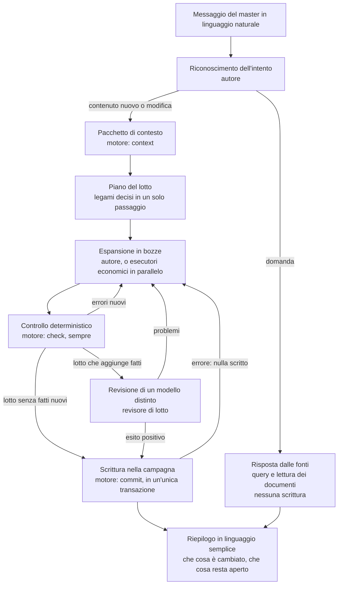

# Architettura

**Stato:** Bozza di progetto. Riscritto dopo la [Riprogettazione](Riprogettazione.md) (2026-11-11).
**Parte di:** [Framework per campagne di GDR](Framework%20per%20campagne%20di%20GDR.md)

Questo documento descrive come è organizzato il framework dopo la Riprogettazione: i tre strati e le loro regole di dipendenza, il motore che scrive la campagna, la struttura del pacchetto che si distribuisce, la struttura di una campagna generata, il percorso di una richiesta dal messaggio del master fino alla versione salvata, e i luoghi in cui vivono stato, versione e personalizzazioni. I principi che giustificano queste scelte sono in [Principi](Principi.md). I nomi interni sono in inglese (decisione dell'indice: il framework è scritto in inglese); i contenuti della campagna restano nella sua lingua.

Le parti marcate hanno questo significato:

- **Deciso**: deriva dall'indice del progetto o dalle decisioni dell'autore. Le decisioni della Riprogettazione portano la data 2026-11-11.
- **Implementato in 0.30.0**: è un fatto realizzato nella versione 0.30.0 del framework.
- **Proposta**: da discutere. Non è ancora una decisione.

Quando una parte della specifica precedente è superata dalla Riprogettazione, il testo è riscritto e la fonte cita la decisione che la sostituisce. Gli esempi di cartelle usano nomi generici e fittizi.

## 1. Tre strati

Il framework è diviso in tre strati. Ogni strato ha responsabilità precise. Lo strato superiore decide, quello inferiore esegue.

**Deciso** nella suddivisione (indice, «Architettura»). La Riprogettazione lascia i tre strati e cambia il loro contenuto (sezioni 1 e 2).

### Strato 1: core

**Responsabilità.**

- Riconoscere che cosa vuole il master a partire dal messaggio in linguaggio naturale. Il riconoscimento è dell'autore, l'agente principale (Riprogettazione, sezione 1 e sezione 8).
- Eseguire i processi del core. Oggi sono realizzati **Implementato in 0.30.0**: `yllir` (ingresso), `new-campaign` (campagna con i soli file core e il seme), `build-world` (costruzione del mondo da uno schema), `write-document` (un documento da una descrizione), `prepare-session`, `after-session`, `import` e `update` (migrazioni dopo un aggiornamento). I processi `live-session`, `maintenance`, `canon-refactor` e `rebalance` del progetto precedente non sono realizzati in 0.30.0 e la Riprogettazione non li cita: sono **Proposta** da riesaminare.
- Applicare le regole fisse del canone tramite il motore: `check` controlla senza scrivere, `commit` valida, collega, aggiorna gli indici, salva la nota sul lavoro in corso e la versione, in un'unica transazione (Riprogettazione, sezione 2; **Implementato in 0.30.0**). La sequenza di scrittura come skill è superata (Riprogettazione, sezione 9).
- Leggere e scrivere la configurazione della campagna, il seme del mondo e lo stato di lavoro (nota sul lavoro in corso, esiti del motore).
- Gestire versioni salvate e controllo degli aggiornamenti. Una versione salvata nasce a ogni `commit` (**Implementato in 0.30.0**). Il ripristino «torna a com'era» è **Proposta**.
- Riprendere il lavoro dal pacchetto di contesto del motore e dalla nota sul lavoro in corso. Argomenti e handoff sono superati (Riprogettazione, decisione 15; **Implementato in 0.30.0**).
- Parlare con il master, con un linguaggio semplice e senza termini interni.

**Non contiene.** Nessun dettaglio di un mondo, di un sistema di gioco o di uno stile visivo. Nessuna regola di gioco. Nessun nome di categoria: le categorie vengono dalla configurazione.

**Esegue direttamente.** Il core scrive in conversazione mondo, schede e scene, perché la scrittura creativa spetta all'agente principale. Delega solo ordini precisi a esecutori economici e la revisione di un lotto a un revisore distinto (Riprogettazione, sezione 1 e decisione 4; **Implementato in 0.30.0**).

### Strato 2: libreria

**Responsabilità.** Operazioni specialistiche richiamate dal core. Sono **Implementate in 0.30.0** due skill di libreria: `document-ingest` (acquisizione e trascrizione di materiale esistente) e `continuity-audit` (verifica di contraddizioni, su richiesta e fuori dalla scrittura).

Le operazioni che nel progetto precedente erano skill di libreria sono diventate librerie di script usate dal motore o dal core: collegamenti (`scripts/lib/links/`), mappa della trama (`scripts/lib/plot/`), schede (`scripts/lib/sheets/`), oggetti (`scripts/lib/items/`). Sono superate come skill separate la ricerca nel canone, che l'autore fa con il motore e la lettura dei documenti, e la gestione dei personaggi (**Implementato in 0.30.0**; Riprogettazione, sezione 9).

Le altre skill di libreria del progetto precedente (intrecci dei personaggi, artwork, carte, stampa, mappe, tracker degli scontri, musica, bilanciamento degli incontri, economia, dottore della campagna, registro della partita, manutenzione della continuità) non sono realizzate in 0.30.0 e la Riprogettazione non le cita. Restano **Proposta** da riesaminare dopo la Riprogettazione.

**Regole.** Le regole seguenti sono **Proposta**.

- Ogni skill di libreria dichiara i file che legge, i file che può scrivere, il contenuto che può produrre e gli strumenti che richiede.
- Una skill di libreria non richiama mai il core. Riceve un compito dal core e restituisce un esito.
- Una skill di libreria può richiamare un'altra skill di libreria solo se la dipendenza è dichiarata, e non può formare cicli. Esempio: `document-ingest` richiama `continuity-audit` su richiesta, e il motore per collegamenti e controlli.
- Le skill di libreria non parlano con il master. Restituiscono un esito tecnico che il core traduce in linguaggio semplice.

### Strato 3: moduli opzionali

**Responsabilità.** Parti del framework attivate dalla configurazione della campagna. Sono di tre tipi:

- **Adattatori di sistema di gioco.** **Deciso** per l'idea che l'adattatore sia uno schema (Riprogettazione, sezione 7). **Implementato in 0.30.0** per D&D 2024 (`modules/systems/dnd-2024/`, con `adapter.yaml` e `checks.mjs`). Il sistema descrive la forma delle schede, la scala delle difficoltà, le risorse e le condizioni; non contiene le tabelle delle regole (Riprogettazione, decisione 10). Un modello generico per i giochi narrativi è **Proposta** (vedi [Sistemi di gioco e stili](Sistemi%20di%20gioco%20e%20stili.md)).
- **Profili di stile.** Indicazioni visive per artwork, carte e mappe. **Proposta**: non realizzati in 0.30.0.
- **Moduli di output.** Stampa, enciclopedia pubblica, strumento grafico del master, ricerca musicale. **Proposta**: non realizzati in 0.30.0.

**Regole.** Le regole seguenti sono **Proposta**.

- Un modulo si attiva solo perché la configurazione lo dichiara. Il core non ne presume la presenza.
- Un modulo espone interfacce dichiarate (schema dei dati, operazioni, esiti). Il core lo chiama solo tramite queste interfacce.
- Un modulo di sistema non dipende da un modulo di stile, e viceversa. Il collegamento passa dal core.
- Un modulo di output legge la sola parte pubblica dei contenuti e non li scrive. Un'uscita non può modificare il canone.

### Regole di dipendenza

La tabella riassume chi può chiamare chi. Le righe del motore e dell'autore sono **Implementate in 0.30.0** (Riprogettazione, sezione 2); le altre sono **Proposta**.

| Chi | Può chiamare | Non può chiamare | Può scrivere |
|---|---|---|---|
| Messaggio del master | Solo l'autore | Libreria, moduli, script direttamente | Nulla direttamente |
| Autore (agente principale) | Motore, esecutori economici, revisore di lotto, skill di libreria | Scrivere nel canone senza il motore | Bozze in `.campaign/drafts/`; i contenuti del canone solo con `commit` |
| Motore (script) | Lettura della campagna e della configurazione; sul controllo, solo una copia temporanea | Agenti, rete, altri script in modo nascosto | Con `check`: solo il proprio esito in `.campaign/state/engine/`. Con `commit`: contenuti, indici, nota sul lavoro in corso, versione salvata. Nulla se c'è un errore |
| Esecutore economico | Solo il proprio ordine e il suo pacchetto di contesto | Decisioni canoniche, altri file | Solo la propria bozza in `.campaign/drafts/` |
| Revisore di lotto | Solo lettura dei file forniti (bozze, canone, seme, piano geografico) | Scrittura, domande dirette al master | Nulla: restituisce un esito, che l'autore registra per il motore |
| Skill di libreria | Altre skill dichiarate, script | Il core, i moduli | I soli contenuti dichiarati |
| Moduli di sistema e di stile | Solo le interfacce del core e le operazioni dichiarate | Altri moduli direttamente, la libreria | Il solo stato del proprio modulo |
| Moduli di output | Lettura della sola parte pubblica dei contenuti | Scrittura nei contenuti del canone | Solo la propria uscita (cartella dedicata in `Uscite/`) |

Due regole trasversali:

- **Nessuno strato inferiore conosce uno superiore.** La libreria non sa di esistere in un framework più grande; riceve compiti.
- **Il conto è del motore, il giudizio è dell'agente.** Il motore non prende decisioni di merito; un agente non fa il lavoro meccanico che il motore può fare in modo completo (Riprogettazione, sezione 2).

## 2. Pacchetto del framework

Il pacchetto è ciò che si installa e si aggiorna. Non contiene nessun contenuto della campagna. La struttura seguente è quella realizzata in 0.30.0 (**Implementato in 0.30.0**), con i nomi interni in inglese.

```text
yllir/                               Repository del framework
  .claude-plugin/plugin.json         Unico punto di distribuzione: plugin per Claude Code
  agents/                            Sub-agent: sheet-expander, batch-reviewer, ingest-reviewer,
                                     audit-extractor, audit-judge, audit-coverage-reviewer
  skills/core/                       Processi: yllir, new-campaign, build-world, write-document,
                                     prepare-session, after-session, import, update
  skills/library/                    document-ingest, continuity-audit
  modules/systems/dnd-2024/          Primo adattatore: adapter.yaml, checks.mjs
  scripts/engine.mjs                 Motore: context, check, commit, query, index
  scripts/lib/engine/                Implementazione del motore
  scripts/lib/links/                 Collegamenti (condiviso)
  scripts/lib/plot/                  Mappa della trama (condiviso)
  scripts/lib/sheets/                Controllo delle schede (condiviso)
  scripts/lib/items/                 Schede degli oggetti (condiviso)
  scripts/lib/adapter-ops.mjs        Operazioni dell'adattatore
  templates/                         content-format.md (riferimento per gli agenti), instructions.md
  hooks/                             Controlli automatici (hooks.json)
  news/                              Note di versione
  *.test.mjs                         Casi di prova accanto a ogni script
```

Note sulla struttura:

- **Distribuzione.** Il framework si distribuisce solo come plugin per Claude Code (**Deciso, 2026-11-11**, Riprogettazione, decisione 11, che supera «Il pacchetto è un plugin per Claude Code e per Codex»). Il file `plugin.json` ne dichiara il contenuto e la versione. Un `manifest.yaml` del pacchetto è **Proposta**.
- **Processi.** Ogni processo sta in `skills/core/<nome>/`, con il suo `SKILL.md`. Il contratto condiviso dai processi è in `skills/core/yllir/authoring.md` (**Implementato in 0.30.0**). La cartella `core/processes/` del progetto precedente è superata.
- **Script di una skill.** **Deciso (2026-11-07):** gli script propri di una skill stanno nella cartella della skill, accanto a `SKILL.md`, in `scripts/`; per esempio la migrazione `world-graph-v1` sta in `skills/core/update/scripts/`. Il codice usato da più skill o dal motore sta in `scripts/lib/` (**Implementato in 0.30.0**: `links`, `plot`, `sheets`, `items`). Il motore non è una skill ed è in `scripts/engine.mjs`.
- **Il motore.** Un solo programma a riga di comando sostituisce il cablaggio di scrittura, il collegamento come skill e i controlli sparsi (Riprogettazione, sezione 2). Le sue operazioni sono `context` (pacchetto di contesto), `check` (controlli senza scrittura), `commit` (scrittura transazionale), `query` (domande strutturate sul mondo) e `index` (indici derivati). Ogni comando stampa JSON e termina con un codice di uscita (**Implementato in 0.30.0**).
- **`templates/`** contiene il riferimento delle regole di formato per gli agenti (`content-format.md`) e i modelli delle schede. Il template delle istruzioni generate è trattato in «Generazione delle istruzioni».
- **`hooks/`** contiene controlli che partono da soli, per esempio il riepilogo della nota sul lavoro in corso all'avvio (**Implementato in 0.30.0**). Il controllo di versione all'avvio è **Proposta**.
- **Casi di prova.** Ogni script ha i propri casi di prova `*.test.mjs` accanto al file (**Implementato in 0.30.0**). I casi girano solo con Claude: il testbench misura solo Claude (Riprogettazione, sezione 11).
- **Superati.** La cartella `orchestration/` del progetto precedente è superata: i ruoli stanno in `agents/`, e la regola di assegnazione in [Orchestrazione degli agenti](Orchestrazione%20degli%20agenti.md) è da riscrivere (Riprogettazione, sezione 1).

### Generazione delle istruzioni

**Proposta**. Il pacchetto include oggi un modello delle istruzioni per gli agenti e un generatore, che scrive un file di istruzioni nella campagna e registra le impronte dei file generati. Il generatore produce anche un file per Codex, che è superato dalla decisione 11. La Riprogettazione non cita la generazione delle istruzioni: se resti, e con quale formato, è una questione aperta (vedi [Questioni aperte](#questioni-aperte)).

## 3. Campagna generata

Una campagna è la cartella creata dal framework per un master. Contiene i contenuti, la configurazione, lo stato di lavoro, i derivati e le versioni salvate.

**Deciso.** Il master può navigare le cartelle da solo, con un editor qualunque, oppure usare il master screen, a sua scelta. La struttura deve quindi essere leggibile a mano: Markdown semplice, link relativi standard, nessun formato che funzioni solo dentro il framework.

**Deciso.** Valgono YAGNI e una sola fonte di verità per ogni cosa (vedi [Principi](Principi.md)). La struttura contiene solo ciò che serve oggi, e ogni informazione ha un solo posto: tutto il resto è derivato e si rigenera.

### Albero

Le cartelle e i file marcati nel testo sotto come realizzati sono **Implementati in 0.30.0**. Il resto è **Proposta**.

```text
mia-campagna/
  campaign.yaml                  Configurazione (vedi Configurazione)
  World seed.md                  Seme del mondo (nome in campaign.seed; "Seme del mondo.md" in italiano)
  .campaign/                     Area di servizio: il master non ci lavora
    state/                       Stato di lavoro, non è canone
      work-note.md               Nota sul lavoro in corso, aggiornata a ogni commit
      engine/                    Esiti di check e di commit (check.json, review.json)
    drafts/                      Bozze del lotto in preparazione; ignorate da git
    cache/                       Derivati rigenerabili: subjects.json, world.json (si possono cancellare)
    version.yaml                 Proposta: versione del framework e impronte dei file generati
    customizations.md            Proposta: regole aggiunte dal master, mai sovrascritte
    instructions/                Proposta: istruzioni generate per gli agenti
  Mondo/                         Luoghi a cascata: l'unica categoria gerarchica
    Calvane.md                   Scheda radice del mondo, creata dall'intervista (Deciso: Mondo/<Nome del mondo>.md)
    Costa di Selce/
      Costa di Selce.md
      Porto di Selce.md
      img/                       Proposta
  Personaggi/                    Personaggi non giocanti, piatti
    Ilde Varno.md
  Creature/                      Creature, piatte
  Oggetti/                       Oggetti, piatti
  Fazioni/                       Fazioni; la cartella è creata da build-world alla prima fazione
  Storia/                        Storia, cosmologia, concetti condivisi; Economia.md è Proposta
  Trama/                         Ciò che il master prepara, una cartella per sessione
    Sessione 1/
      Sessione 1.md              File principale della sessione: derivato, rigenerato dal motore
      Eventi/                    Proposta: un file per evento principale
  Cronaca/                       Ciò che è successo davvero, una pagina per sessione giocata
    2026-11-14.md
  Giocatori/                     Proposta: personaggi giocanti, tutto riservato al master
  Fonti/                         Originali acquisiti (foto, PDF, scansioni)
  Appunti/                       Proposta: spunti e bozze fuori dal canone
  Uscite/                        Proposta: tutto ciò che si rigenera (enciclopedia, fogli di stampa, viste per luogo)
```

Note sulla struttura:

- **Categorie.** Le cartelle dei contenuti sono nella lingua della campagna e si fissano alla creazione; i processi le leggono dalla configurazione (`structure[].folder`), non le scrivono nelle istruzioni. La struttura è facoltativa alla creazione: la campagna nasce con i file core e il seme, e una cartella compare quando nasce la prima scheda della sua categoria (vedi [Configurazione](Configurazione.md)). Le categorie `Fazioni/`, `Personaggi/`, `Creature/` e `Oggetti/` sono quelle usate dai modelli di 0.30.0.
- **Cartella e tipo.** Il tipo del soggetto è dichiarato nei metadati (`kind`, vedi sotto). La cartella resta la categoria di collocazione.
- **Seme del mondo.** Documento nella radice, nominato in `campaign.seed` (**Implementato in 0.30.0**). Tutto il suo contenuto sta nel blocco riservato del master, perché descrive il lavoro dell'autore.
- **File di sessione.** Il file principale di ogni sessione è derivato e viene rigenerato dal motore a ogni scrittura (**Implementato in 0.30.0**). Il master non lo modifica a mano.

### Struttura prima per categoria, poi per geografia

**Deciso** (indice, 2026-11-10; confermato dalla Riprogettazione, decisione 9). Ogni categoria conserva la propria radice (`Mondo/`, `Personaggi/`, `Creature/`, `Oggetti/` e così via), poi organizza i documenti per luoghi. La scheda del luogo descrive la gerarchia geografica; ogni altro soggetto è canonico al comune antenato della categoria e delle sue location esplicitamente registrate, sia nella scheda corrente sia nei metadati `appearances` degli eventi. Se non ha una location nota, sta in `Da collocare`, tradotto nella lingua della campagna. Il percorso non aggiunge fatti: riflette solo i dati espliciti.

**Implementato in 0.30.0**: il piano geografico è calcolato e verificato dal motore dentro `check` e `commit`. Non è più una catena di passi eseguita dal modello, e la sua revisione da parte di un modello non è più richiesta (Riprogettazione, decisione 14).

I file delle scene restano nelle cartelle della sessione e restano le fonti originali. Le viste geografiche sono symlink rigenerabili verso quegli stessi file, mai copie: **Proposta**. Per i luoghi con sotto-luoghi la scheda canonica si chiama come la cartella (`Mondo/Costa di Selce/Costa di Selce.md`); per un luogo foglia il file è sotto la cartella del suo luogo contenitore (`Mondo/Costa di Selce/Porto.md`).

`Trama/` è organizzata per sessione: una cartella per sessione, con il file principale (derivato) e gli eventi in `Eventi/`. **Proposta (2026-11-09):** l'arco non è più una cartella; se serve raggrupparle, lo si dichiara nei metadati e non nel percorso.

Ripetere le stesse aree in più categorie, con lo stesso nome da mantenere allineato a mano, è il modo di fallimento che questa struttura evita: rinominare un luogo tocca una sola cartella.

### Dove sta ogni informazione

| Informazione | Unico posto | Derivato da lì |
|---|---|---|
| Nome di un soggetto | Il titolo `#` della scheda | Nome del file, voci dell'enciclopedia, testo dei link |
| Forme alternative del nome | `aliases` nei metadati | Indice dei soggetti (`.campaign/cache/subjects.json`), che non si scrive a mano |
| Identità stabile | `id` nei metadati in testa alla scheda | Route dell'enciclopedia, QR delle carte (**Proposta**) |
| Tipo di soggetto | `kind` nei metadati (**Implementato in 0.30.0**) | Regole di creazione, controlli del grafo, indice del mondo |
| Modello della scheda (solo per le categorie con più modelli) | `template` nei metadati | Validazione della forma della scheda |
| Relazione fra soggetti | `relations`, con il tipo (appartenenza, parentela, alleanza, rivalità, dipendenza) | Indice del mondo, pacchetto di contesto |
| Cronologia di un evento | `when` (numero sulla linea del tempo del mondo), `ended` per la fine di un soggetto | Controlli del grafo (azioni dopo la fine, presenze contemporanee) |
| Stato di un soggetto | `status` (per esempio vivo o morto, attivo o distrutto) | Controlli del grafo, pacchetto di contesto |
| Provenienza | `provenance` (`master`, `played`, `generated`) | Regole di riscrittura e di avviso al master (Riprogettazione, sezione 6) |
| Abbozzo | `sketch: true` | Elenco degli abbozzi da espandere |
| Presenza esplicita di un soggetto in una scena | `appearances` nel frontmatter dell'evento, con ID del soggetto e dei luoghi | Percorso canonico del soggetto e viste geografiche |
| Luogo attuale di un personaggio, una creatura, un oggetto | `location` nei metadati (uno o più `id` di luoghi) | Percorso canonico del soggetto e vista «chi e che cosa c'è qui» (**Proposta** per la vista) |
| Gerarchia dei luoghi | La posizione della cartella in `Mondo/` | Percorsi, breadcrumb, carte del mondo |
| Prerequisito di una sessione | `depends_on` nei metadati della sessione | Mappa della trama |
| Che cosa è successo al tavolo | La pagina di `Cronaca/` | Riepilogo «dove eravamo rimasti» (nota sul lavoro in corso) |
| Stato attuale di un soggetto dopo il gioco | La scheda, aggiornata dal processo `after-session`, che applica i fatti dichiarati dal master (**Implementato in 0.30.0**) | — |
| Documento del mondo | Il seme, nominato in `campaign.seed` | Contesto di ogni scrittura |
| Parte riservata | Il blocco master in fondo alla scheda (vedi [Principi](Principi.md), principio 4) | Esclusione automatica da ogni uscita |
| Stato di stampa di una carta | `print` nei metadati della scheda dell'oggetto (**Proposta**) | Fogli di stampa |
| Regole economiche (valute, prezzi base, salari, variazioni per luogo) | `Storia/Economia.md` (**Proposta**) | Controllo dei prezzi nelle schede |
| Forma standard di una scheda | Il modello del suo tipo, in `templates/` | Validazione delle schede |
| Stato di lavoro (nota, esiti del motore) | `.campaign/state/` | Riepilogo di ripresa, pacchetto di contesto |

Regole che ne discendono:

- **Metadati minimi.** In testa alla scheda stanno solo i dati che non sono già nel testo: `id`, `kind` e `provenance`, e quando servono `location`, `relations`, `status`, `ended`, `when`, `sketch`, `appearances`, `depends_on`, `merged_ids` (dopo un'unione), `aliases` e `template` (vedi [Formato dei contenuti](Formato%20dei%20contenuti.md#12-metadati-in-testa)). Il nome non si ripete nei metadati. I metadati li scrive e li legge il framework; il master non deve toccarli, ma se apre il file li trova leggibili. Il campo `print` è **Proposta**.
- **Il tipo nei metadati.** Il tipo non si deduce più dalla cartella: lo dichiara `kind`, e la cartella è solo la categoria di collocazione (Riprogettazione, sezione 3). Il criterio «il tipo lo dice la cartella» del progetto precedente è superato.
- **Una sola dichiarazione della presenza.** `characters` elenca chi agisce o parla; da solo non dice dove si trova. Solo `appearances` dichiara che un soggetto è presente in uno o più luoghi per una specifica scena. Menzioni, personaggi, oggetti e link non bastano per inferire la presenza (**Deciso**, indice, 2026-11-10).
- **Una sola posizione, quella attuale.** Il luogo nei metadati è quello di adesso. La storia degli spostamenti non si tiene in un campo: è già nella cronaca, ed è da lì che l'audit di continuità la ricava se serve (**Proposta**).
- **Preparato e accaduto sono separati.** `Trama/` contiene ciò che il master prepara e non si riscrive dopo il gioco per farlo coincidere con ciò che è successo. `Cronaca/` registra gli eventi giocati. I cambiamenti di canone finiscono nelle schede; la cronaca racconta, non ridefinisce (**Proposta**).
- **Rinomine sicure.** Il nome del file segue il titolo. Rinomine, unioni, divisioni, spostamenti e cancellazioni passano dalla [manutenzione della continuità](Skill%20di%20libreria.md#l19-manutenzione-della-continuità): è una skill **Proposta**, non realizzata in 0.30.0. L'`id` resta stabile, quindi QR stampati ed enciclopedia continuano a funzionare.
- **Una scheda senza parte pubblica non si pubblica.** Un soggetto interamente segreto ha tutto nel blocco riservato; le uscite pubbliche lo saltano, titolo compreso. Non serve un campo di visibilità (**Proposta**).
- **Immagini accanto alla scheda.** Ogni categoria, e ogni cartella di `Mondo/`, ha la sua `img/`. L'immagine finale e il suo sorgente a livelli stanno insieme, con lo stesso nome base (**Proposta**).
- **Le uscite non sono canone.** `Uscite/`, `.campaign/cache/` e i file principali delle sessioni si possono cancellare e rigenerare. Nessun processo legge un'uscita come fonte (**Implementato in 0.30.0** per cache e file di sessione; **Proposta** per `Uscite/`).
- **Giocatori interamente riservato.** Ciò che sta in `Giocatori/` non entra in nessuna uscita pubblica. Gli originali dei personaggi giocanti stanno in `Fonti/`. Le informazioni che i giocatori possono conoscere stanno nelle schede delle altre categorie (**Proposta**).

### Fuori dalla prima versione (YAGNI)

Si aggiungono solo quando una campagna reale ne ha bisogno:

- archivi storici in sola lettura separati dal canone;
- una cronologia delle posizioni nei metadati;
- una cartella separata o un archivio esterno per i sorgenti pesanti delle immagini;
- nessun livello geografico ulteriore oltre ai dati espliciti che già determinano la posizione canonica.

## 4. Flusso di una richiesta

Il flusso che segue descrive il percorso di una richiesta come «crea un luogo nuovo», «cambia il nome di questo personaggio», «prepara la sessione di domani» o «ho scansionato le lettere di Ilde Varno», dal messaggio del master fino alla versione salvata.

La sequenza di scrittura in nove passi del progetto precedente, eseguita come skill da un modello economico, è **superata** (Riprogettazione, sezione 9; [Processi di core](Processi%20di%20core.md)). Al suo posto c'è il motore, chiamato dall'autore con poche operazioni.

Il master viene coinvolto solo quando una decisione canonica non può essere presa dal framework (**Proposta**). Il diagramma segue lo stato di 0.30.0 (**Implementato in 0.30.0**, salvo dove indicato).



Note sul flusso:

- **Punto di ingresso.** Il master scrive o parla. Non sceglie mai un processo, né una skill. L'autore riconosce l'intento (Riprogettazione, sezione 8). La ripresa del lavoro dipende dal pacchetto di contesto del motore e dalla nota sul lavoro in corso, senza argomenti e handoff (Riprogettazione, decisione 15; **Implementato in 0.30.0**).
- **Pacchetto di contesto.** Prima di scrivere, l'autore chiede al motore il contesto: il seme, il soggetto e i vicini nel grafo, la cronologia pertinente, i fili aperti della cronaca, gli errori del grafo sul soggetto (**Implementato in 0.30.0**).
- **Piano del lotto.** Quando il master chiede molti contenuti insieme, l'autore decide tutti i legami in una scaletta breve, prima di scrivere le schede. Le righe che non vengono espanse subito si salvano come abbozzi (Riprogettazione, sezione 5, decisione 13). Un documento singolo non ha scaletta. Il piano è un'operazione dell'autore (**Deciso, 2026-11-11**).
- **Espansione.** L'autore scrive le schede da sé (fino a tre) o le affida a esecutori economici, uno per scheda, in parallelo. Il valore di partenza è implementato e va tarato con il testbench (Riprogettazione, decisione 16).
- **Controllo.** `check` valida formato, grafo, schema dell'adattatore, schede, oggetti, configurazione, mappa della trama, collegamenti e piano geografico, su una copia temporanea. Blocca solo gli errori nuovi. Gli errori tornano all'autore, non al master (**Implementato in 0.30.0**).
- **Revisione.** È richiesta solo per i lotti che aggiungono fatti al canone (Riprogettazione, decisione 5). Il revisore vede il canone, il seme e il blocco riservato, e giudica solo le contraddizioni di senso, i segreti nel testo pubblico e le invenzioni presentate come citazioni. Non controlla il formato (**Implementato in 0.30.0**).
- **Scrittura.** `commit` applica il lotto in un'unica transazione: controllo delle modifiche a mano, collegamenti sicuri, rigenerazione dei file di sessione, indici, nota sul lavoro in corso, versione salvata. Se qualcosa non va, non scrive nulla (**Implementato in 0.30.0**).
- **Modifiche a mano.** Un documento cambiato a mano dal master non viene sovrascritto: il motore lo segnala all'autore, che lo lascia com'è e avvisa il master (Riprogettazione, decisione 12; **Implementato in 0.30.0**).
- **Audit di continuità.** Non fa più parte della scrittura. Si esegue su richiesta, per il documento o per l'intera campagna (Riprogettazione, decisione 5; **Implementato in 0.30.0**).
- **Cicli limitati.** Al massimo tre cicli fra espansione e controllo o revisione. Oltre, il processo si ferma e chiede al master (**Proposta**).
- **Versione salvata dopo la verifica.** Ogni `commit` riuscito salva una versione (**Implementato in 0.30.0**). Il ripristino «torna a com'era» è **Proposta**: il master non deve compiere alcun gesto per la versione.
- **Riepilogo.** L'autore dice in poche frasi che cosa ha creato o cambiato, e che cosa resta aperto, senza termini tecnici. Nessuna scelta di modello o di processo viene riportata (Riprogettazione, sezione 5 e principio 1).
- **Registro della partita.** Il registro di ciò che accade durante la sessione live non è realizzato in 0.30.0: **Proposta**.
- **Costo.** L'autore riceve l'esito del controllo, quello della revisione e il contesto compatto, non i file completi. Questo limita il costo del modello di alto livello (**Proposta**).

## 5. Stato, versione, personalizzazioni

Il framework distingue i tipi di dati che vivono in luoghi diversi. La regola generale è che ogni tipo ha un solo luogo e un solo proprietario.

| Tipo di dato | Dove vive | Chi lo scrive | Chi lo legge | Come si aggiorna |
|---|---|---|---|---|
| Contenuti della campagna (schede, sessioni, cronaca, storia) | Cartelle della campagna | L'autore, tramite `commit`; il master | Tutto il framework | Tramite il flusso di richiesta; migrazioni dichiarate per i cambi di struttura (**Implementato in 0.30.0**) |
| Seme del mondo | Documento nella radice, nominato in `campaign.seed` | L'autore, quando il mondo cresce; il master, parlando | L'autore, il revisore di lotto | Aggiornato a ogni informazione sul mondo (Riprogettazione, sezione 4) |
| Configurazione (`campaign.yaml`) | Radice della campagna | Il framework, nella creazione o su richiesta | Tutto il framework | Modifica dichiarata; conferma per i cambi che alterano la struttura |
| Versione del framework e impronte dei file generati | `.campaign/version.yaml` (**Proposta**) | Il framework, all'installazione o all'aggiornamento | Controllo all'avvio, processo di aggiornamento | Aggiornamento; registrata dopo ogni migrazione riuscita |
| Istruzioni per gli agenti | `.campaign/instructions/` (**Proposta**) | Il generatore | Gli agenti | Rigenerate a ogni cambio di configurazione o versione; non modificate a mano |
| Personalizzazioni del master | `.campaign/customizations.md` (**Proposta**) | Il master (tramite il framework) | Il generatore, le skill | Mai sovrascritte dagli aggiornamenti |
| Stato di lavoro (nota sul lavoro in corso, esiti del motore) | `.campaign/state/` | Il motore (a ogni `commit`) | L'autore, il riepilogo all'avvio | Aggiornato a ogni scrittura; non è canone |
| Bozze del lotto in preparazione | `.campaign/drafts/` (ignorata da git) | L'autore e gli esecutori economici | Il motore | Sostituite a ogni lotto; cancellabili |
| Derivati (indice dei soggetti, indice del mondo, file principali delle sessioni) | `.campaign/cache/` e i file di sessione in `Trama/` | Il motore | L'autore, il core | Rigenerati dopo ogni scrittura; si possono cancellare (**Implementato in 0.30.0**) |
| Derivati di uscita (enciclopedia, fogli di stampa, viste per luogo) | `Uscite/` (**Proposta**) | Script deterministici | Il master | Rigenerati dopo ogni scrittura |
| Versioni salvate | Storico git della cartella della campagna, invisibile al master | Il motore, dopo ogni `commit` riuscito | Solo il ripristino | Mai modificate (**Implementato in 0.30.0**) |
| Pacchetto del framework | Installazione del plugin di Claude Code | Solo il distributore | Il core | Sostituito dall'aggiornamento, senza toccare la campagna |

Punti da chiarire nel dettaglio (in [Configurazione](Configurazione.md) e [Aggiornamenti e migrazioni](Aggiornamenti%20e%20migrazioni.md)):

- **Versioni salvate.** **Deciso** (indice, «Git dalla prima creazione»): lo storico git della cartella è l'unica fonte delle versioni, anche per gli aggiornamenti; nessuna copia parallela. Git si inizializza alla creazione della campagna ed è un requisito: senza git il framework non scrive. Il master non deve sapere che sotto c'è git. Per il backup, l'unica copia remota possibile è un repository git privato dell'utente, che si attiva solo se lo vuole: è la sua copia e contiene anche il riservato (vedi [Sicurezza e privacy](Sicurezza%20e%20privacy.md)).
- **Dove sta la versione.** Il file `.campaign/version.yaml` è **Proposta**: il codice lo usa, ma la Riprogettazione non lo cita. Il pacchetto dichiara la propria versione in `.claude-plugin/plugin.json`, e il confronto fra le due è il controllo all'avvio.
- **Personalizzazioni.** **Proposta**. Restano in un file che il master possiede. Il generatore le leggerebbe e le includerebbe nelle istruzioni, senza mai riscriverle. Un conflitto fra una personalizzazione e una nuova versione del framework verrebbe segnalato al master, con la scelta esplicita.
- **Stato di lavoro.** Non è canone. Una partita, uno scontro o un registro si possono cancellare senza alterare la campagna. Argomenti e handoff non esistono più: la ripresa usa la nota sul lavoro in corso (Riprogettazione, decisione 15; **Implementato in 0.30.0**).

## Questioni aperte

- **Nome e repository.** Il pacchetto e la campagna generata hanno bisogno di nomi. Il pacchetto va in un repository separato da ogni campagna (decisione dell'indice, da completare).
- **Forma dei moduli.** Va scelto se un modulo è una cartella con un manifest o un file singolo. Va deciso anche se gli adattatori di sistema e gli stili sono intercambiabili fra campagne o fissati alla creazione.
- **Hook su Codex.** Superata dalla Riprogettazione (2026-11-11): il plugin per Codex è rimosso (decisione 11), quindi non serve più verificarne gli hook.
- **Orchestrazione.** La tabella delle regole di dipendenza presume che gli esecutori economici scrivano solo la propria bozza in `.campaign/drafts/`. Va verificato che il modello economico rispetti questo limite.
- **Nomi delle cartelle per lingua.** **Deciso (2026-11-07):** non esiste una tabella di nomi predefiniti. L'agente traduce i nomi nella lingua della campagna e li mostra nella conferma unica dell'intervista; da lì la configurazione li fissa.
- **Versioni salvate in una cartella dello stesso progetto.** Lo storico nella cartella della campagna cresce nel tempo. Va stabilito un limite o una politica di pulizia, decisa dal master.
- **Strumenti esterni.** Il collegamento con applicazioni esterne (per esempio il programma di grafica) avviene tramite MCP o altro. Va scelto come le operazioni esterne vengono descritte nel manifest.
- **Istruzioni generate e personalizzazioni** (nuova, 2026-11-11). Il pacchetto 0.30.0 contiene ancora un generatore delle istruzioni per gli agenti, con un file per Codex, e le personalizzazioni del master (`.campaign/customizations.md`). La Riprogettazione non cita né l'uno né le altre, e toglie le istruzioni di ripiego per Codex. Va deciso se il generatore resta, con quale formato, e che cosa fa delle personalizzazioni.
