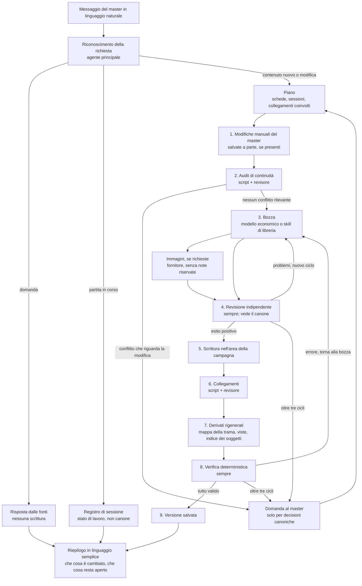

# Architettura

**Stato:** Bozza di progetto
**Parte di:** [Framework per campagne di GDR](Framework%20per%20campagne%20di%20GDR.md)

Questo documento descrive come è organizzato il framework: i tre strati e le loro regole di dipendenza, la struttura del pacchetto che si distribuisce, la struttura di una campagna generata, il percorso di una richiesta dal messaggio del master fino alla versione salvata, e i luoghi in cui vivono stato, versione e personalizzazioni. I principi che giustificano queste scelte sono in [Principi](Principi.md). I nomi interni sono in inglese (decisione dell'indice: il framework è scritto in inglese); i contenuti della campagna restano nella sua lingua.

Le parti marcate **Deciso** derivano dall'indice del progetto o dalle decisioni dell'autore. Tutto il resto è una **Proposta** da discutere. Gli esempi di cartelle usano nomi generici e fittizi.

## 1. Tre strati

Il framework è diviso in tre strati. Ogni strato ha responsabilità precise. Lo strato superiore decide, quello inferiore esegue.

**Deciso** nella suddivisione (indice, «Architettura»).

### Strato 1: core

**Responsabilità.**

- Riconoscere che cosa vuole il master a partire dal messaggio in linguaggio naturale.
- Scegliere il processo da attivare: `new-campaign`, `prepare-session`, `live-session`, `after-session`, `maintenance`, `import`, `canon-refactor`, `rebalance`.
- Applicare le regole fisse di sicurezza del canone, nella sequenza di scrittura definita in [Processi di core](Processi%20di%20core.md#cablaggio-di-scrittura): audit di continuità prima della scrittura, revisione indipendente, collegamenti dopo la scrittura, rigenerazione dei derivati, verifica deterministica, versione salvata.
- Leggere e scrivere la configurazione della campagna e lo stato di lavoro.
- Gestire versioni salvate, ripristino, sessioni di lavoro (argomenti e handoff) e controllo degli aggiornamenti.
- Parlare con il master, con un linguaggio semplice e senza termini interni.

**Non contiene.** Nessun dettaglio di un mondo, di un sistema di gioco o di uno stile visivo. Nessuna regola di gioco. Nessun nome di categoria: le categorie vengono dalla configurazione.

**Esegue direttamente.** Il core decide e coordina. Il lavoro di scrittura di merito è delegato alla libreria, ai moduli o a un sub-agent.

### Strato 2: libreria

**Responsabilità.** Un insieme di skill specialistiche, ciascuna con un compito preciso e un contratto di ingresso e uscita. Sono le operazioni che il core richiama. Gli id dell'indice sono: `document-ingest`, `continuity-audit`, `linker`, `canon-research`, `plot-map`, `pc-weaving`, `sheets`, `npc-manager`, `artwork`, `cards`, `print`, `maps`, `combat-tracker`, `music-search`, `encounter-balancer`, `economy-manager`, `campaign-doctor`, `session-log`, `continuity-keeper`.

**Regole.**

- Ogni skill di libreria dichiara nel proprio manifest i file che legge, i file che può scrivere, il contenuto che può produrre e gli strumenti che richiede.
- Una skill di libreria non richiama mai il core. Riceve un compito dal core e restituisce un esito.
- Una skill di libreria può richiamare un'altra skill di libreria solo se la dipendenza è dichiarata nel manifest, e non può formare cicli. Esempio: `document-ingest` richiama `continuity-audit` e `linker`, nell'ordine dichiarato.
- Le skill di libreria non parlano con il master. Restituiscono un esito tecnico che il core traduce in linguaggio semplice.

### Strato 3: moduli opzionali

**Responsabilità.** Parti del framework attivate dalla configurazione della campagna. Sono di tre tipi:

- **Adattatori di sistema di gioco:** traducono le regole di un gioco (scontri, risorse, difficoltà, progressione) in dati e operazioni che il framework usa. L'adattatore è dichiarato in `system.adapter`. D&D 2024 è il primo adattatore; un modello generico (risorse, orologi, tracce) è da definire per i giochi narrativi (vedi [Sistemi di gioco e stili](Sistemi%20di%20gioco%20e%20stili.md), da completare).
- **Profili di stile:** indicazioni visive per artwork, carte e mappe. Ogni categoria dichiara il proprio profilo in `structure[].style`.
- **Moduli di output:** `print` (stampa), `encyclopedia` (enciclopedia pubblica), `master_screen` (strumento grafico del master), `music` (ricerca musicale).

Le funzioni di libreria (ingest, intrecci, mappa della trama, artwork, scontri, economia) non sono moduli: partono quando servono.

**Regole.**

- Un modulo si attiva solo perché la configurazione lo dichiara. Il core non ne presume la presenza.
- Un modulo espone interfacce dichiarate (schema dei dati, operazioni, esiti). Il core lo chiama solo tramite queste interfacce.
- Un modulo di sistema non dipende da un modulo di stile, e viceversa. Il collegamento passa dal core.
- Un modulo di output legge la sola parte pubblica dei contenuti e non li scrive. Un'uscita non può modificare il canone.

### Regole di dipendenza

La tabella riassume chi può chiamare chi. Le regole valgono per il pacchetto e per tutti gli script.

| Chi | Può chiamare | Non può chiamare | Può scrivere |
|---|---|---|---|
| Messaggio del master | Solo il core (tramite l'agente principale) | Libreria, moduli, script direttamente | Nulla direttamente |
| Core | Libreria, moduli, script, sub-agent | Nulla che sia fuori dal manifest | Configurazione, stato di lavoro, versioni salvate, contenuti tramite la sequenza di scrittura |
| Skill di libreria | Altre skill di libreria dichiarate, script | Il core, i moduli | I soli contenuti dichiarati nel manifest |
| Moduli di sistema e di stile | Solo le interfacce del core e le operazioni dichiarate | Altri moduli direttamente, la libreria | Il solo stato del proprio modulo |
| Moduli di output | Lettura della sola parte pubblica dei contenuti | Scrittura nei contenuti del canone | Solo la propria uscita (cartella dedicata in `Uscite/`) |
| Script deterministici | Solo librerie di sistema e lettura dei file | Agenti, rete, altri script in modo nascosto | Solo i file indicati come argomento |
| Sub-agent di revisione | Solo lettura dei file forniti | Scrittura, domande dirette al master | Nulla (restituisce un esito) |
| Sub-agent di esecuzione | Solo i file del compito | Decisioni canoniche | Solo i file del compito, restituiti al core |

Due regole trasversali:

- **Nessuno strato inferiore conosce uno superiore.** La libreria non sa di esistere in un framework più grande; riceve compiti.
- **Il conto è dello script, il giudizio è dell'agente.** Uno script non prende decisioni di merito; un agente non fa il lavoro meccanico che uno script può fare in modo completo.

## 2. Pacchetto del framework

Il pacchetto è ciò che si installa e si aggiorna. Non contiene nessun contenuto della campagna. Qui sotto la proposta di struttura, con i nomi interni in inglese.

```text
framework-campagne/              Proposta: repository separato, nome da scegliere
  README.md                      Per chi installa il pacchetto, non per il master
  manifest.yaml                  Nome, versione, elenco di processi, skill, moduli, migrazioni
  core/
    processes/                   Processi di core, una cartella per processo
      new-campaign/SKILL.md
      prepare-session/SKILL.md
      live-session/SKILL.md
      after-session/SKILL.md
      maintenance/SKILL.md
      import/SKILL.md
      canon-refactor/SKILL.md
      rebalance/SKILL.md
  skills/
    library/                     Skill di libreria (una cartella per skill)
      document-ingest/
      continuity-audit/
      linker/
      canon-research/
      plot-map/
      pc-weaving/
      sheets/                    Schede: luoghi, oggetti, creature, personaggi non giocanti
      npc-manager/               Personaggi non giocanti, nemici e venditori standardizzati
      artwork/
      cards/
      print/
      maps/
      combat-tracker/
      music-search/
      encounter-balancer/
      economy-manager/
      campaign-doctor/
      session-log/
      continuity-keeper/
  modules/
    systems/                     Adattatori di sistema di gioco
      dnd-2024/
      generico/                  Da definire
    styles/                      Profili di stile visivo
      dark-fantasy/              Esempio di profilo di stile
      rotolo-dipinto/            Esempio di profilo di stile
    outputs/                     Stampa, enciclopedia, master screen, musica
  scripts/                       Operazioni deterministiche condivise da più skill o dal core, in Node.js (vedi sotto)
  templates/                     Modelli: configurazione, istruzioni per gli agenti, schede tipo
  migrations/                    Migrazioni dichiarate, una per passaggio di versione
  hooks/                         Controlli automatici all'avvio e prima o dopo una scrittura
  tests/                         Casi di prova con esito atteso
  orchestration/                 Ruoli degli agenti e assegnazione dei modelli
```

Note sulla struttura:

- **`manifest.yaml`** è l'unico punto in cui il pacchetto dichiara che cosa contiene. Il core non scopre le skill cercando file: legge l'elenco. Questo rende possibili le verifiche sulle dipendenze.
- **`core/processes/`** contiene anche le regole comuni a tutti i processi, compresa la sequenza di scrittura.
- **Script di una skill.** **Deciso (2026-11-07):** gli script propri di una skill stanno nella cartella della skill, accanto a `SKILL.md`, in `scripts/` (per esempio `skills/library/linker/scripts/`), insieme ai dati che usa solo lei. In `scripts/` alla radice del pacchetto resta solo il codice usato da più skill o dal core.
- **`scripts/`** contiene le operazioni condivise che non cambiano per il modello usato: elenco di tutte le menzioni di un soggetto e dei suoi alias, controllo dei collegamenti, validazione del blocco riservato, rigenerazione degli indici derivati, controllo delle dipendenze fra sessioni, validazione della configurazione e della struttura delle cartelle. Sono scritti in Node.js (esempi `.mjs`).
- **`templates/`** contiene i modelli da cui si generano le istruzioni per gli agenti (vedi la sezione successiva). Non contiene istruzioni scritte a mano per un solo agente.
- **`hooks/`** contiene controlli che partono da soli (per esempio il confronto della versione all'avvio). La disponibilità degli hook varia fra Claude e Codex: è da verificare. Dove un hook non esiste, il controllo è eseguito dal core come primo passo del processo.
- **`tests/`** contiene casi di prova per gli script e per le skill di libreria (per esempio: il collegamento a una menzione in un punto preciso; il rifiuto di un blocco riservato non chiuso). I casi girano con Claude e, se attivo, con Codex.
- **`orchestration/`** descrive quale agente fa che cosa. Il contenuto vero sta in [Orchestrazione degli agenti](Orchestrazione%20degli%20agenti.md).

### Generazione delle istruzioni

**Proposta**. Le istruzioni per gli agenti non si scrivono a mano per ciascun agente. Il pacchetto contiene:

1. un modello unico delle regole (nei processi di `core/processes/`, compresa la sequenza di scrittura);
2. un modello per ciascun agente (Claude, e Codex se attivo), che adatta il formato e il livello di esplicitezza;
3. il generatore, che combina il modello con la configurazione della campagna e con le personalizzazioni dell'utente.

Il file generato va in `.campaign/instructions/`, porta l'avvertenza «generato, non modificare» e viene rigenerato a ogni aggiornamento o modifica della configurazione. Le personalizzazioni dell'utente sono incluse per riferimento, ma non vengono copiate nel pacchetto.

## 3. Campagna generata

Una campagna è la cartella creata dal framework per un master. Contiene i contenuti, la configurazione, lo stato di lavoro, i derivati e le versioni salvate.

**Deciso.** Il master può navigare le cartelle da solo, con un editor qualunque, oppure usare il master screen, a sua scelta. La struttura deve quindi essere leggibile a mano: Markdown semplice, link relativi standard, nessun formato che funzioni solo dentro il framework.

**Deciso.** Valgono YAGNI e una sola fonte di verità per ogni cosa (vedi [Principi](Principi.md)). La struttura contiene solo ciò che serve oggi, e ogni informazione ha un solo posto: tutto il resto è derivato e si rigenera.

### Albero

**Proposta.**

```text
mia-campagna/
  campaign.yaml                  Configurazione (vedi Configurazione)
  .campaign/                     Area di servizio: il master non ci lavora
    version.yaml                 Versione del framework, ultima migrazione, impronte dei file generati
    customizations.md            Regole aggiunte dal master, mai sovrascritte
    instructions/                Istruzioni generate per gli agenti
    state/                       Stato di lavoro: partita in corso, scontro in corso, aggiornamento in corso
      topics/                    Argomenti di lavoro e handoff (vedi Gestione delle sessioni)
    cache/                       Derivati rigenerabili, per esempio subjects.json (si può cancellare)
  Mondo/                         Luoghi a cascata: l'unica categoria gerarchica
    Calvane.md                   Scheda radice del mondo, creata dall'intervista (Deciso: Mondo/<Nome del mondo>.md)
    Costa di Selce/
      Costa di Selce.md
      Porto di Selce.md
      img/
  Personaggi/                    Personaggi non giocanti, piatti
    Ilde Varno.md
    img/
  Creature/                      Creature, piatte
  Oggetti/                       Oggetti, piatti; le carte stanno in img/
  Storia/                        Storia, cosmologia, concetti condivisi, Economia.md
  Trama/                         Ciò che il master prepara, per arco
    Il faro spento/              Un arco: una cartella
      Sessione 1.md
  Cronaca/                       Ciò che è successo davvero, una pagina per sessione giocata
    2026-11-14.md
  Giocatori/                     Personaggi giocanti: una scheda per personaggio, tutto riservato al master
    Nome del personaggio.md
  Fonti/                         Originali acquisiti (foto, PDF, scansioni), anche delle schede dei personaggi giocanti
  Appunti/                       Spunti e bozze: non canone
  Uscite/                        Tutto ciò che si rigenera: mappa della trama, enciclopedia,
                                 fogli di stampa, viste per luogo
```

I nomi delle cartelle dei contenuti sono nella lingua della campagna e si fissano alla creazione; i processi li leggono dalla configurazione (`structure[].folder`), non li scrivono nelle istruzioni. La struttura è facoltativa alla creazione: la campagna nasce con i file core, e una cartella compare quando nasce la prima scheda della sua categoria (vedi [Configurazione](Configurazione.md)).

### Perché solo il mondo è a cascata

La geografia è gerarchica per natura: un porto sta in una costa, una costa in una regione. Per questo `Mondo/` è l'unica categoria a cascata. Personaggi (`Personaggi/`), creature (`Creature/`) e oggetti (`Oggetti/`) invece non hanno un posto fisso: un personaggio viaggia, un oggetto passa di mano, una creatura vive in più regioni. Se la cartella ne indicasse il luogo, il luogo sarebbe scritto due volte (nella cartella e nella scheda) e la cartella invecchierebbe male. Per questo queste tre categorie sono piatte, e il luogo è un dato della scheda (`location`).

`Trama/` è organizzata per arco: una cartella per arco, con dentro le sessioni. È un ordine di lavoro, non un luogo, e non ripete la gerarchia del mondo.

Ripetere le stesse aree in più categorie, con lo stesso nome da mantenere allineato a mano, è il modo di fallimento che questa struttura evita: rinominare un luogo tocca una sola cartella.

### Dove sta ogni informazione

| Informazione | Unico posto | Derivato da lì |
|---|---|---|
| Nome di un soggetto | Il titolo `#` della scheda | Nome del file, voci dell'enciclopedia, testo dei link |
| Forme alternative del nome | `aliases` nei metadati | Indice dei soggetti (`.campaign/cache/subjects.json`), che non si scrive a mano |
| Identità stabile | `id` nei metadati in testa alla scheda | Route dell'enciclopedia, QR delle carte |
| Tipo di soggetto | La cartella di categoria | Regole di creazione e di collegamento |
| Modello della scheda (solo per le categorie con più modelli) | `template` nei metadati | Validazione della forma della scheda |
| Luogo attuale di un personaggio, una creatura, un oggetto | `location` nei metadati (uno o più `id` di luoghi) | Vista «chi e che cosa c'è qui» per ogni luogo |
| Gerarchia dei luoghi | La posizione della cartella in `Mondo/` | Percorsi, breadcrumb, carte del mondo |
| Prerequisito di una sessione | `depends_on` nei metadati della sessione | Mappa della trama |
| Che cosa è successo al tavolo | La pagina di `Cronaca/` | Riepilogo «dove eravamo rimasti» |
| Stato attuale di un soggetto dopo il gioco | La scheda, aggiornata dal processo `after-session` | — |
| Parte riservata | Il blocco master in fondo alla scheda (vedi [Principi](Principi.md), principio 4) | Esclusione automatica da ogni uscita |
| Stato di stampa di una carta | `print` nei metadati della scheda dell'oggetto | Fogli di stampa |
| Regole economiche (valute, prezzi base, salari, variazioni per luogo) | `Storia/Economia.md` | Controllo dei prezzi nelle schede |
| Forma standard di una scheda | Il modello del suo ruolo o tipo, nel pacchetto del framework | Validazione delle schede |
| Stato di lavoro (partita, scontro, registro) | `.campaign/state/` | Sessione live, scontri |

Regole che ne discendono:

- **Metadati minimi.** In testa alla scheda stanno solo i dati che non sono già nel testo: `id`, e quando servono `location`, `depends_on`, `print`, `merged_ids` (dopo un'unione), `aliases` e `template` (vedi [Formato dei contenuti](Formato%20dei%20contenuti.md#12-metadati-in-testa)). Il nome non si ripete nei metadati, e il tipo non si dichiara: lo dice la cartella. I metadati li scrive e li legge il framework; il master non deve toccarli, ma se apre il file li trova leggibili.
- **Una sola posizione, quella attuale.** Il luogo nei metadati è quello di adesso. La storia degli spostamenti non si tiene in un campo: è già nella cronaca, ed è da lì che l'audit di continuità la ricava se serve.
- **Preparato e accaduto sono separati.** `Trama/` contiene ciò che il master prepara e non si riscrive dopo il gioco per farlo coincidere con ciò che è successo. `Cronaca/` registra gli eventi giocati. I cambiamenti di canone finiscono nelle schede; la cronaca racconta, non ridefinisce.
- **Rinomine sicure.** Il nome del file segue il titolo. Rinomine, unioni, divisioni, spostamenti e cancellazioni passano dalla [manutenzione della continuità](Skill%20di%20libreria.md#l19-manutenzione-della-continuità) (`continuity-keeper`): l'`id` resta stabile, quindi QR stampati ed enciclopedia continuano a funzionare.
- **Una scheda senza parte pubblica non si pubblica.** Un soggetto interamente segreto ha tutto nel blocco riservato; le uscite pubbliche lo saltano, titolo compreso. Non serve un campo di visibilità.
- **Immagini accanto alla scheda.** Ogni categoria, e ogni cartella di `Mondo/`, ha la sua `img/`. L'immagine finale e il suo sorgente a livelli stanno insieme, con lo stesso nome base.
- **Le uscite non sono canone.** `Uscite/`, `.campaign/instructions/` e `.campaign/cache/` si possono cancellare e rigenerare. Nessun processo legge un'uscita come fonte.
- **Giocatori interamente riservato.** Ciò che sta in `Giocatori/` non entra in nessuna uscita pubblica. Gli originali dei personaggi giocanti stanno in `Fonti/`. Le informazioni che i giocatori possono conoscere stanno nelle schede delle altre categorie.

### Fuori dalla prima versione (YAGNI)

Si aggiungono solo quando una campagna reale ne ha bisogno:

- archivi storici in sola lettura separati dal canone;
- una cronologia delle posizioni nei metadati;
- una cartella separata o un archivio esterno per i sorgenti pesanti delle immagini;
- sottocartelle per area nelle categorie piatte.

## 4. Flusso di una richiesta

Il flusso che segue descrive il percorso di una richiesta come «crea un luogo nuovo», «cambia il nome di questo personaggio», «prepara la sessione di domani» o «ho scansionato le lettere di Ilde Varno», dal messaggio del master fino alla versione salvata.

Il diagramma segue la sequenza di scrittura definita in [Processi di core](Processi%20di%20core.md#cablaggio-di-scrittura), con i suoi nove passi numerati. Il master viene coinvolto solo nel nodo «Domanda al master», e solo per decisioni canoniche. I passi di bozza, immagine e revisione sono delegati a skill di libreria o a sub-agent, e sono controllati dall'agente principale.



Note sul flusso:

- **Punto di ingresso.** Il master scrive o parla. Non sceglie mai un processo, né una skill. Il riconoscimento è compito dell'agente principale, che può chiedere chiarimenti su contenuti, mai su strumenti. Il cambio di argomento e gli handoff tra sessioni di lavoro sono descritti in [Gestione delle sessioni](Gestione%20delle%20sessioni.md).
- **Audit di continuità prima della scrittura.** È una regola di processo, non un'abitudine affidata alla memoria dell'agente. Un conflitto che riguarda la modifica va presentato al master prima di scrivere, e la scrittura si ferma. Un conflitto estraneo alla modifica va elencato a parte.
- **Revisione indipendente, sempre.** Il revisore riceve la bozza e le fonti del canone, comprese le note riservate, perché controlla il canone. I revisori dei testi destinati ai giocatori (enciclopedia, carte, riepiloghi) non le ricevono mai. Se la revisione non può essere eseguita, il processo si ferma e non dichiara il testo verificato.
- **Cicli limitati.** Ci sono al massimo tre cicli fra bozza e revisione, o fra scrittura e verifica. Oltre, il processo si ferma e chiede al master.
- **Versione salvata dopo la verifica.** Il ripristino riporta alla versione salvata precedente. Le modifiche fatte a mano dal master si salvano in una versione a parte prima di iniziare il lavoro. Il «torna a com'era» non richiede alcun gesto del master.
- **Verifica deterministica.** È l'ultima barriera. Un errore riporta alla bozza, non alla risposta al master: il master vede solo il risultato finale o una domanda.
- **Costo.** L'agente principale riceve soltanto la bozza, l'esito del revisore e l'esito degli script, non i file completi. Questo limita il costo del modello di alto livello.

## 5. Stato, versione, personalizzazioni

Il framework distingue i tipi di dati che vivono in luoghi diversi. La regola generale è che ogni tipo ha un solo luogo e un solo proprietario.

| Tipo di dato | Dove vive | Chi lo scrive | Chi lo legge | Come si aggiorna |
|---|---|---|---|---|
| Contenuti della campagna (schede, sessioni, cronaca, storia) | Cartelle della campagna | Il core, tramite la sequenza di scrittura; il master | Tutto il framework | Tramite il flusso di richiesta; migrazioni dichiarate per i cambi di struttura |
| Configurazione (`campaign.yaml`) | Radice della campagna | Il core, nel processo `new-campaign` o su richiesta | Tutto il framework | Modifica dichiarata; conferma per i cambi che alterano la struttura |
| Versione del framework e impronte dei file generati | `.campaign/version.yaml` | Solo il framework, all'installazione o all'aggiornamento | Controllo all'avvio, skill di aggiornamento | Aggiornamento; registrata dopo ogni migrazione riuscita |
| Istruzioni per gli agenti | `.campaign/instructions/` | Il generatore | Gli agenti | Rigenerate a ogni cambio di configurazione o versione; non modificate a mano |
| Personalizzazioni del master | `.campaign/customizations.md` | Il master (tramite il framework) | Il generatore, le skill | Mai sovrascritte dagli aggiornamenti |
| Stato di lavoro (partite, scontri, registro, argomenti, handoff) | `.campaign/state/` | Il core e i moduli di sistema | Il core | Aggiornato durante la sessione; non è canone |
| Derivati (indice dei soggetti, mappa della trama, enciclopedia, fogli di stampa) | `.campaign/cache/` e `Uscite/` | Script deterministici | Il core, le skill | Rigenerati dopo ogni scrittura; si possono cancellare |
| Versioni salvate | Storico git della cartella della campagna, invisibile al master | Il core, dopo ogni modifica verificata | Solo il ripristino | Mai modificate |
| Pacchetto del framework | Installazione dello strumento (plugin o cache) | Solo il distributore | Il core | Sostituito dall'aggiornamento, senza toccare la campagna |

Punti da chiarire nel dettaglio (in [Configurazione](Configurazione.md) e [Aggiornamenti e migrazioni](Aggiornamenti%20e%20migrazioni.md)):

- **Versioni salvate.** Deciso (indice, «Git dalla prima creazione»): lo storico git della cartella è l'unica fonte delle versioni, anche per gli aggiornamenti; nessuna copia parallela. Git si inizializza alla creazione della campagna ed è un requisito: senza git il framework non scrive. Il master non deve sapere che sotto c'è git. Per il backup (indice), l'unica copia remota possibile è un repository git privato dell'utente, che si attiva solo se lo vuole: è la sua copia e contiene anche il riservato (vedi [Sicurezza e privacy](Sicurezza%20e%20privacy.md)).
- **Dove sta la versione.** Il file `.campaign/version.yaml` è la sola fonte per la versione del framework della campagna, e contiene anche le impronte dei file generati. Il pacchetto dichiara la propria versione in `manifest.yaml`. Il confronto fra le due è il controllo all'avvio.
- **Personalizzazioni.** Restano in un file che il master possiede. Il generatore le legge e le include nelle istruzioni, senza mai riscriverle. Un conflitto fra una personalizzazione e una nuova versione del framework viene segnalato al master, con la scelta esplicita.
- **Stato di lavoro.** Non è canone e non passa dalla sequenza di scrittura. Una sessione live, uno scontro o un registro si possono cancellare senza alterare la campagna.

## Questioni aperte

- **Nome e repository.** Il pacchetto e la campagna generata hanno bisogno di nomi. Il pacchetto va in un repository separato da ogni campagna (decisione dell'indice, da completare).
- **Forma dei moduli.** Va scelto se un modulo è una cartella con un manifest o un file singolo. Va deciso anche se gli adattatori di sistema e gli stili sono intercambiabili fra campagne o fissati alla creazione.
- **Hook su Codex.** La disponibilità di hook e controlli all'avvio per Codex non è stata verificata. Se non esiste, il controllo di versione va eseguito dal core come primo passo, con costo di tempo per ogni sessione.
- **Orchestrazione.** La tabella delle regole di dipendenza presume che il sub-agent di esecuzione non abbia scrittura diretta sui contenuti. Va verificato che il modello economico rispetti questo limite.
- **Nomi delle cartelle per lingua.** **Deciso (2026-11-07):** non esiste una tabella di nomi predefiniti. L'agente traduce i nomi nella lingua della campagna e li mostra nella conferma unica dell'intervista; da lì la configurazione li fissa.
- **Versioni salvate in una cartella dello stesso progetto.** Lo storico nella cartella della campagna cresce nel tempo. Va stabilito un limite o una politica di pulizia, decisa dal master.
- **Strumenti esterni.** Il collegamento con applicazioni esterne (per esempio il programma di grafica) avviene tramite MCP o altro. Va scelto come le operazioni esterne vengono descritte nel manifest.
