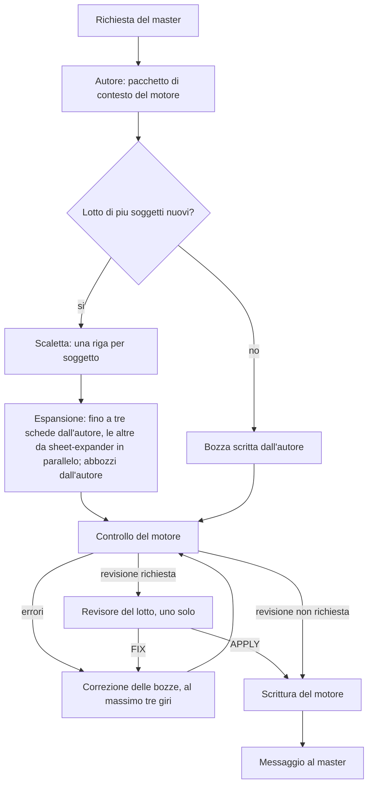

# Orchestrazione degli agenti

**Stato:** Bozza di progetto
**Parte di:** [Framework per campagne di GDR](Framework%20per%20campagne%20di%20GDR.md)

Riscritto dopo la [Riprogettazione](Riprogettazione.md) (2026-11-11).

Questo file descrive come il framework distribuisce il lavoro fra l'agente principale (l'autore), gli esecutori economici, i revisori indipendenti e il motore deterministico. Descrive il framework com'è nella versione 0.30.0. Dove la [Riprogettazione](Riprogettazione.md) contraddice una regola precedente, vale la Riprogettazione, e il testo lo cita fra parentesi.

Ogni affermazione è marcata così:

- **Deciso** indica una decisione presente nell'indice dell'autore e non superata.
- **Deciso, 2026-11-11** indica una decisione della Riprogettazione, con il numero della decisione o la sezione.
- **Implementato in 0.30.0** indica un fatto verificato nella versione attuale.
- **Proposta** indica un'idea di questo documento, da confermare.
- **Superata** indica una regola precedente sostituita da una decisione più recente, citata.

Gli esempi riguardano una campagna tipica: la creazione di un borgo con i suoi personaggi, la preparazione di una sessione, la revisione di un lotto di schede.

## Principi

- **Deciso, 2026-11-11** (decisione 4). La scrittura creativa è dell'agente principale. L'autore scrive mondo, schede, scene e cronaca nella conversazione con il master. I modelli economici restano per contenere il costo, ma eseguono ordini precisi e delimitati.
- **Deciso, 2026-11-11** (decisioni 1 e 3). L'autore parla con il master e decide. Il master non sceglie modelli, livelli di costo né modalità: le scelte tecniche le fa il framework.
- **Deciso, 2026-11-11** (decisione 16). Quando far scrivere una scheda a un modello economico lo decide il framework, in base alla dimensione del lavoro. La soglia iniziale si tara con il testbench: la specifica non fissa una cifra.
- **Deciso.** I compiti si assegnano per punti di forza del modello, non solo per costo.
- **Deciso, 2026-11-11** (decisione 5). La revisione è proporzionata. I controlli deterministici girano sempre. La revisione di un modello distinto avviene solo sui lotti che aggiungono fatti al canone. Supera «Revisione indipendente sempre» dell'indice.
- **Superata dalla Riprogettazione (2026-11-11)** (decisione 5): «La revisione indipendente è sempre presente. Ogni scrittura passa da un sub-agent distinto da chi l'ha prodotta, anche quando la prosa è scritta dall'agente principale.» Ragione: la revisione di un modello è solo sui lotti che aggiungono fatti.
- **Deciso, 2026-11-11** (decisione 14). Un lotto che sposta soltanto documenti, senza aggiungere fatti, non ha la revisione di un modello.
- **Deciso, 2026-11-11** (decisioni 4 e 11). Claude è l'unico fornitore del framework. Il plugin per Codex è rimosso. Codex, se presente, è al più un fornitore facoltativo di immagini. Modifica «Codex è facoltativo» e «Il pacchetto è un plugin per Claude Code e per Codex» dell'indice.
- **Superata dalla Riprogettazione (2026-11-11)** (decisione 11): «Claude è il fornitore di base. Codex è facoltativo: se è installato, lavora accanto a Claude per i compiti in cui rende meglio; senza Codex il framework funziona con i soli modelli Claude.» Ragione: Codex resta solo come fornitore facoltativo di immagini.
- **Implementato in 0.30.0.** Ogni scrittura passa dal motore, che controlla e poi salva in un'unica transazione. Nessun documento della campagna viene scritto direttamente.
- **Superata.** «I sub-agent sono obbligatori: nessun passo di esecuzione o revisione si fa nel contesto del solo agente principale» (Riprogettazione, sezione 1). L'autore scrive nella conversazione principale. I sub-agent restano per l'espansione in parallelo di più schede, per la revisione di un lotto e per i lavori di lettura (trascrizione e audit).
- **Superata.** «Un agente principale con un modello di alto livello decide e supervisiona; l'esecuzione va sempre a modelli economici, sempre sotto revisione» (Riprogettazione, decisione 4 e sezione 1). Il lavoro creativo non va più ai modelli economici.

## Ruoli

| Ruolo | Chi lo svolge | Fa | Non fa |
| --- | --- | --- | --- |
| Autore (agente principale) | Modello di alto livello di Claude, nella conversazione principale | Parla con il master e decide il canone; scrive mondo, schede, abbozzi, scene e cronaca come bozze; prepara il contesto, la scaletta e i lotti; decide quando delegare. *Deciso, 2026-11-11* (decisioni 4 e 16). | Non scrive i file della campagna direttamente: passa dal motore. Non fa girare processi al posto suo: non esiste un esecutore di processi. *Implementato in 0.30.0.* |
| Esecutore economico | `yllir:sheet-expander`, modello Haiku | Espande una riga della scaletta in una scheda completa, a partire da un pacchetto di contesto salvato; scrive un solo file e risponde con una riga. *Implementato in 0.30.0.* | Non sceglie legami, che sono già nella riga. Non tocca altri file. Non chiede nulla al master. |
| Revisore del lotto | `yllir:batch-reviewer`, sub-agent distinto, in sola lettura | Giudica solo le contraddizioni di senso con il canone (documenti `master` o `played`) e con il seme, i segreti nel testo pubblico, le invenzioni presentate come citazioni. Risponde con `APPLY` o `FIX`. *Implementato in 0.30.0.* | Non controlla il formato: lo fa il motore. Non modifica file. Non parla con il master. |
| Lettori e revisori di importazione e audit | `yllir:ingest-reviewer` (confronto riga per riga di una trascrizione); `yllir:audit-extractor`, `yllir:audit-judge`, `yllir:audit-coverage-reviewer` (audit di continuità), tutti Haiku | Verificano la trascrizione di un documento importato; l'audit estrae e giudica i fatti, su richiesta. *Implementato in 0.30.0.* | Non fanno parte del ciclo di scrittura: l'audit non parte da solo. |
| Motore (verificatore deterministico) | `scripts/engine.mjs`, un programma senza modello | Controlla formato, schema dell'adattatore e aritmetica, grafo del mondo, mappa della trama, link; calcola la collocazione geografica; rileva le modifiche a mano; salva indici, nota sul lavoro e versione. *Implementato in 0.30.0.* | Non giudica il senso dei testi. |
| Master | L'utente | Prende le decisioni di canone e di identità; risponde alle domande; parla in linguaggio comune. | Non deve conoscere i ruoli: li vede solo come «un controllo» o «una bozza». |

### Visibilità del blocco riservato

**Deciso.** Vedono il blocco riservato gli agenti che lavorano sul canone: l'autore; gli esecutori che scrivono documenti della campagna, perché il loro pacchetto di contesto contiene il seme; il revisore del lotto, che deve controllarlo; gli agenti di trascrizione e di audit.

Non lo ricevono mai le ricerche web e i fornitori di immagini, né i servizi di pubblicazione. *Deciso, 2026-11-11* (decisione 10): una ricerca sulle regole non riceve mai il blocco riservato. Il seme del mondo sta per intero nel blocco riservato (ciò che esce dalla campagna non deve contenerlo).

Questa regola sostituisce quella secondo cui i sub-agent ricevono solo la parte pubblica.

## Il ciclo di scrittura

Passi, con il criterio di uscita di ciascuno:

1. **Contesto.** L'autore esegue il comando `context` per i soggetti, il luogo o la sessione coinvolti, e legge il seme. *Uscita:* pacchetto letto. *Implementato in 0.30.0.*
2. **Scaletta.** Solo per un lotto di più soggetti nuovi: una riga per soggetto, con tutti i legami già decisi, in `.campaign/drafts/outline.md`. Una richiesta singola è un lotto di uno, senza scaletta. *Uscita:* una riga per soggetto, con legami e frase. *Deciso, 2026-11-11* (Riprogettazione, sezione 5).
3. **Espansione.** Ogni riga che serve subito diventa una scheda completa. Le altre diventano abbozzi (`sketch: true`), scritti dall'autore: nessuna riga della scaletta si perde. Fino a tre schede le scrive l'autore. Oltre, parte un `sheet-expander` per scheda, tutti nello stesso messaggio, ciascuno con il proprio file di destinazione. *Uscita:* bozze in `.campaign/drafts/`. *Implementato in 0.30.0.* Il numero tre è il valore iniziale; la soglia si tara con il testbench (*Deciso, 2026-11-11*, decisione 16).
4. **Controllo.** Il comando `check` esamina tutte le bozze del lotto senza scrivere nulla. Se ci sono errori, l'autore corregge le bozze e rifà il controllo, al massimo tre giri. *Uscita:* nessun errore. *Gli errori meccanici sono del motore (implementato in 0.30.0); il limite di tre giri è una* **Proposta**.
5. **Revisione.** Solo se il controllo dice che la revisione è richiesta, cioè se il lotto aggiunge fatti al canone. Un solo `batch-reviewer` per lotto. Esito `FIX`: si corregge la bozza indicata e si torna al passo 4. Esito `APPLY`: si passa al passo 6. La risposta si salva così com'è in `.campaign/state/engine/review.json`. *Uscita:* esito `APPLY` più recente del controllo, con lo stesso identificativo delle bozze. *Deciso, 2026-11-11* (decisione 5); *implementato in 0.30.0*, dove il motore rifiuta la scrittura senza questo esito.
6. **Scrittura.** Il comando `commit` con gli stessi file del controllo. In un'unica transazione: salva prima le modifiche a mano come versione a parte; rifiuta i file cambiati a mano dopo l'ultima versione; applica la collocazione geografica; risolve i link sicuri; rigenera le schede di sessione derivate e gli indici; scrive la nota sul lavoro in corso; salva una versione. Se qualcosa non va, non scrive nulla. Le menzioni ambigue le giudica l'autore. *Uscita:* versione salvata. *Implementato in 0.30.0.*
7. **Messaggio.** L'autore dice al master che cosa è stato creato o cambiato, che cosa è inventato e che cosa è solo un abbozzo. *Deciso, 2026-11-11* (Riprogettazione, sezioni 5 e 6).

Il revisore non controlla il formato: gli errori meccanici (campo mancante, tabella malformata, link rotto, collocazione in conflitto) tornano all'autore dal motore, prima di ogni revisione. *Deciso, 2026-11-11* (Riprogettazione, sezione 2).

## Ordine agli esecutori

**Superata.** Il brief a campi obbligatori della versione precedente (Task, Files to read, Files you may write, Do not, Exit criteria, Report) non si usa più. Argomenti e handoff sono eliminati (Riprogettazione, sezione 9 e decisione 15).

Un esecutore riceve un ordine con chiavi fisse, una per riga, e risponde in un formato fisso. *Implementato in 0.30.0.* Per l'espansione di una scheda, le chiavi sono `CAMPAIGN_ROOT`, `LINE`, `TARGET`, `CONTEXT`, `TEMPLATE`, `FORMAT`, `LANGUAGE`, `PROVENANCE`, ed esse sono descritte nel contratto dell'autore (`yllir/skills/core/yllir/authoring.md`, sezione 6). Per il revisore del lotto, le chiavi sono `CAMPAIGN_ROOT`, `DRAFTS`, `FINAL_FILES`, `SEED` e `INTENT`; il revisore restituisce un solo oggetto JSON con l'esito.

Le regole per i modelli economici stanno nel contratto e nell'ordine stesso, non in un documento separato di principi. Il documento [Principi](Principi.md) va riscritto.

## Assegnazione dei compiti ai modelli

Questa è l'unica tabella dei modelli del framework. Le skill non assegnano modelli per conto proprio.

| Compito | Modello | Revisione | Base della scelta |
| --- | --- | --- | --- |
| Canone, identità, scelte narrative | Agente principale (modello di alto livello) | Revisore del lotto, se il lotto aggiunge fatti; il master decide il canone | **Deciso** (indice: «il principale decide»); *Deciso, 2026-11-11* (decisione 4). *Superata dalla Riprogettazione (2026-11-11)*: «Revisore indipendente, sempre» (decisione 5). |
| Scrittura creativa: mondo, scaletta, abbozzi, scene, cronaca | Agente principale | Come sopra | *Deciso, 2026-11-11* (decisione 4; sezione 1) |
| Schede complete in serie | Haiku (`sheet-expander`), dopo le prime tre schede dell'autore | Revisore del lotto e controllo del motore | *Implementato in 0.30.0*; la soglia è *Deciso, 2026-11-11* (decisione 16) |
| Trascrizione di foto e scansioni | Da scegliere con una prova comparativa | Il revisore della trascrizione (`ingest-reviewer`, Haiku) riga per riga; il master per i dubbi di lettura | **Questione aperta** |
| Estrazione dei fatti e audit di continuità (solo su richiesta) | Haiku (`audit-extractor`, `audit-judge`, `audit-coverage-reviewer`) | Fuori dal ciclo di scrittura | *Implementato in 0.30.0* |
| Immagini | Codex, se installato, come fornitore facoltativo; nessun fornitore è ancora realizzato | L'agente principale confronta l'immagine con la descrizione verificata | *Deciso, 2026-11-11* (decisioni 4 e 11); i fornitori e il loro ordine sono **Proposta**, vedi [Integrazioni esterne](Integrazioni%20esterne.md) |
| Statistiche, prezzi ed effetti delle regole | Conoscenza del modello, o una ricerca web che non riceve mai il blocco riservato; lo schema dell'adattatore li valida | Controllo di forma e aritmetica del motore | *Deciso, 2026-11-11* (decisione 10) |
| Controlli meccanici (formato, grafo, link, collocazione, versioni) | Nessun modello: il motore | Non serve | *Implementato in 0.30.0* |

Regola di fondo. **Deciso, 2026-11-11** (decisione 4). L'esecutore lavora con un ordine scritto, e il suo risultato passa sempre dal motore e, quando richiesto, dal revisore. L'autore scrive in prima persona tutto ciò che è creativo e fino a tre schede per lotto.

**Superata.** «Il modello di alto livello non scrive in serie» (versione precedente): la Riprogettazione lo descrive come una delle cause della lentezza (sezione 1, «Perché») e fa scrivere le schede agli esecutori economici solo oltre la soglia della decisione 16.

## Come una skill dichiara i passi delegabili

**Superata.** La tabella `## Delega` per ogni skill non si usa più: la delega la decide il framework (*Deciso, 2026-11-11*, decisione 16) e le skill sono processi brevi, descritti in [Processi di core](Processi%20di%20core.md) e non in procedure passo per passo (Riprogettazione, sezione 8).

## Parallelismo e conflitti sui file

*Implementato in 0.30.0:*

- Ogni esecutore scrive in `.campaign/drafts/` il proprio file di destinazione, e nessun altro. Le bozze non toccano la campagna prima del commit.
- La scrittura nella campagna è un solo `commit` del motore, in sequenza.
- Gli indici, le schede di sessione derivate e la nota sul lavoro in corso sono scritti solo dal motore, nel commit.
- Il motore rifiuta un lotto che contiene un file cambiato a mano dopo l'ultima versione.

*Proposta:*

- Prima di lanciare esecutori in parallelo, l'autore verifica che i file di destinazione siano distinti.
- I revisori operano in sola lettura. Un revisore che modifica un file invalida il proprio esito.

**Superata.** «Ogni esecutore lavora su una copia separata del progetto, e il principale integra i risultati uno alla volta»: le bozze in `.campaign/drafts/` e il commit unico la sostituiscono.

## Codex

**Deciso, 2026-11-11** (decisione 11). Il framework si distribuisce solo come plugin per Claude Code. Il plugin per Codex e le istruzioni di ripiego per Codex sono rimossi (*Implementato in 0.30.0*). Codex, se presente, è al più un fornitore facoltativo di immagini (decisione 4).

**Superate dalla Riprogettazione (2026-11-11)** (decisione 11 e sezione 9) le regole specifiche per Codex della versione precedente: attesa di input, percorsi assoluti per i file di lavoro, e l'obbligo di lanciare ogni esecutore con il modello Luna esplicito. Erano: «In Codex i sub-agent non scelgono da soli un modello più semplice… ogni sub-agent esecutore deve essere lanciato esplicitamente con Luna» e «Un sub-agent lanciato in Codex senza il modello indicato è un difetto». Non esistono più esecutori Luna nel framework.

## Costi

**Proposta, qualitativa.** Non si stimano cifre: i prezzi cambiano e il framework non deve fissarli nelle proprie regole.

- L'autore lavora sulla parte corta: decisioni, scalette, lettura dei risultati. Il volume grosso (schede in serie) va agli esecutori economici.
- Un revisore per lotto, non per documento. Il revisore è presente solo sui lotti che aggiungono fatti (*Deciso, 2026-11-11*, decisione 5).
- Il framework conta le chiamate per operazione e le mostra su richiesta, così il master può vedere il costo reale senza leggere i log. Questo conteggio non è ancora implementato nella versione 0.30.0.

### Revisione proporzionata

**Superata: la classificazione a tre livelli.** La versione precedente calcolava per ogni scrittura un livello basso, medio o alto, con uno script di classificazione, e per il livello alto un revisore per documento. Il livello non esiste nella versione 0.30.0 e la decisione 5 non lo richiede.

Regole che la sostituiscono:

- I controlli deterministici girano sempre. *Implementato in 0.30.0.*
- Un solo revisore del lotto, solo se il lotto aggiunge fatti al canone. Il motore calcola il bisogno di revisione e lo dichiara nel risultato del controllo. *Deciso, 2026-11-11* (decisione 5); *implementato in 0.30.0.*
- Nessuna revisione per i lotti che cambiano solo la collocazione o che differiscono solo per la marcatura dei link. *Deciso, 2026-11-11* (decisione 14); *implementato in 0.30.0.*
- Nessun audit di continuità automatico nel ciclo di scrittura: l'audit è su richiesta. *Deciso* (indice, «Controllo del canone nella revisione della scrittura», 2026-11-10); *implementato in 0.30.0.*

## Fallback

| Situazione | Comportamento |
| --- | --- |
| Revisione non riuscita o non disponibile | Nulla si scrive: il motore accetta il commit solo con un esito `APPLY` più recente del controllo. Il lotto resta in bozza e il master è informato in una frase. Non si dichiara mai una revisione avvenuta. *Implementato in 0.30.0.* |
| Verifica deterministica fallita | `check` esce con errori e non scrive nulla. L'autore corregge le bozze, fino a tre giri; poi dice al master che cosa blocca il lotto. Il numero tre è una **Proposta**. |
| Esecutore non disponibile o che non restituisce il file | L'autore scrive la scheda da sé, con lo stesso controllo e la stessa revisione. **Proposta.** |
| Fornitore di immagini non disponibile | **Deciso:** la generazione di immagini non dipende per forza da Codex; passa al fornitore successivo secondo l'ordine configurato (vedi [Integrazioni esterne](Integrazioni%20esterne.md)); se non ce n'è nessuno, la generazione si ferma e lo si comunica. **Proposta:** il framework spiega al master in una frase come rimediare, e completa il resto del lavoro. |
| File cambiato a mano dopo l'ultima versione | Il commit lo rifiuta; le modifiche a mano si salvano prima in una versione a parte, e il master è avvisato in una frase. *Implementato in 0.30.0.* |

**Superate** le righe della versione precedente su Codex non installato e sul ripiego a Luna: non ci sono più né Codex né Luna nel framework (*Deciso, 2026-11-11*, decisione 11).

## Sessioni e argomenti

**Superata** (Riprogettazione, decisione 15; sezione 9). Non ci sono più argomenti, handoff né una sessione «portineria» che li passa fra sub-agent. Per riprendere il lavoro bastano il pacchetto di contesto del motore (`context`) e la nota sul lavoro in corso, `.campaign/state/work-note.md`, che il motore aggiorna a ogni salvataggio. *Implementato in 0.30.0.*

Il documento [Gestione delle sessioni](Gestione%20delle%20sessioni.md) descrive ancora la versione precedente e va riscritto.

## Questioni aperte

Le questioni marcate **Superata dalla Riprogettazione (2026-11-11)** restano qui per memoria, con la ragione.

- Quale modello di alto livello usare come agente principale, e con quale nome nella configurazione. *Aperta.* Il master non sceglie il modello (decisione 3): resta da decidere solo il nome interno.
- Haiku o Luna per il codice: serve una prova comparativa su compiti reali del framework. **Superata dalla Riprogettazione (2026-11-11):** Luna non è più un modello del framework (decisione 11). Il tema del codice di sviluppo, se ancora interessa, va riaperto a parte.
- Il revisore deve essere di famiglia diversa dall'esecutore, o basta un altro modello della stessa famiglia? **Superata dalla Riprogettazione (2026-11-11):** il framework funziona solo con Claude (decisione 11) e il testbench misura solo Claude (sezione 11).
- Chi fissa le soglie (tre tentativi, tempi di attesa di Codex): il framework o la configurazione della campagna? *Aperta* per il limite di tre tentativi. I tempi di attesa di Codex sono **superati dalla Riprogettazione (2026-11-11)**, decisione 11.
- Dove vivono i brief: nella cartella del progetto, per essere riusabili, o nella cartella temporanea, per non sporcare la cartella della campagna? **Superata dalla Riprogettazione (2026-11-11):** non ci sono più brief (sezione 9).
- Il framework registra i costi per operazione o solo il numero di chiamate? *Aperta.*
- Come si valida la tabella dei passi delegabili: un controllo automatico alla modifica della skill, o una revisione manuale? **Superata dalla Riprogettazione (2026-11-11):** la tabella per skill non esiste più; la delega la decide il framework (decisione 16).
- **Pesi e soglie iniziali del livello di controllo.** Vanno tarati sul testbench, con i casi con trappole (omonimi, alias, contraddizioni lontane, ipotesi che non devono diventare accuse, esclusioni registrate): i casi con trappole devono risultare `high`. **Superata dalla Riprogettazione (2026-11-11):** i livelli di controllo non esistono più (decisione 5).
- **Punteggio continuo.** Invece dei tre livelli si potrebbe usare un punteggio continuo con soglie. Conviene, o i tre livelli bastano? **Superata dalla Riprogettazione (2026-11-11):** non ci sono livelli, né tre né continui (decisione 5).
- **Esclusioni registrate.** Dove vivono le esclusioni registrate (ciò che non deve essere segnalato) e devono entrare fra le misure della classificazione? **Superata dalla Riprogettazione (2026-11-11):** la classificazione è stata eliminata (decisione 5). Le esclusioni registrate restano un tema per il testbench, da riprendere lì.
- **Regola dei link «ovvi».** La regola del livello basso (nome proprio di almeno due parole maiuscole) è prudente e può essere allargata solo dopo averla misurata sul testbench. **Superata dalla Riprogettazione (2026-11-11):** il linker come skill è eliminato (sezione 9); i link sicuri li applica il motore, e la loro regola va misurata sul testbench.
- **Costo del revisore per documento.** Al livello alto il revisore per documento raddoppia le chiamate: va misurato il costo reale, con il conteggio delle chiamate per operazione che il framework già tiene. **Superata dalla Riprogettazione (2026-11-11):** un revisore per lotto, non per documento (decisione 5). Il costo reale resta da misurare, come nella domanda sul conteggio delle chiamate.
- **Aggiunta (2026-11-11), da verificare.** Un lotto che modifica solo il seme del mondo richiede la revisione? La Riprogettazione dice che la revisione riguarda i lotti che aggiungono fatti al canone, e il seme è un fatto di tutto il mondo, ma il motore non è ancora stato verificato su questo caso.
