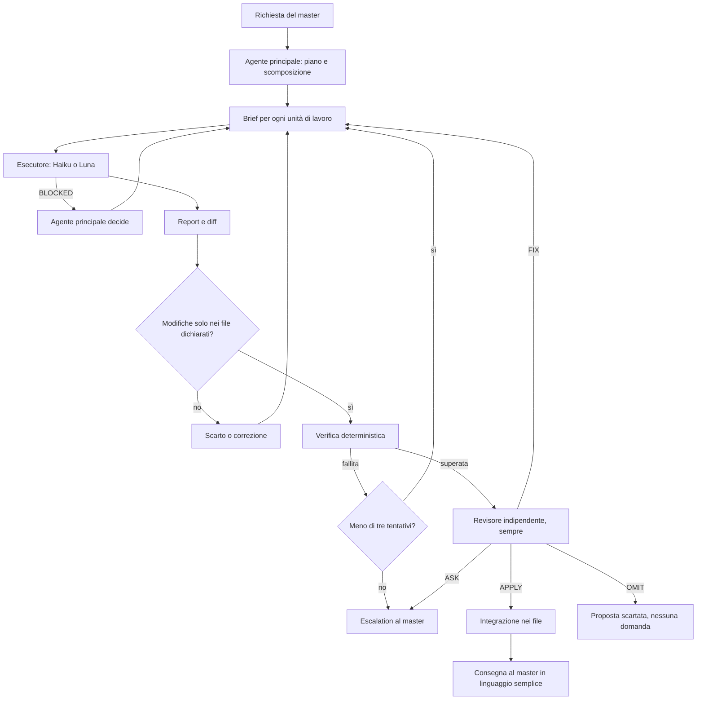

# Orchestrazione degli agenti

**Stato:** Bozza di progetto
**Parte di:** [Framework per campagne di GDR](Framework%20per%20campagne%20di%20GDR.md)

Questo file descrive come il framework distribuisce il lavoro fra un agente principale, gli esecutori economici e i revisori indipendenti. Ogni affermazione è marcata in uno dei due modi: **Deciso** indica una decisione presente nell'indice dell'autore; **Proposta** indica un'idea di questo documento, da confermare. Gli esempi che seguono riguardano compiti tipici di una campagna: il collegamento delle menzioni, l'audit di continuità, la generazione di immagini per le schede e il tracciamento di uno scontro o di una sessione.

## Principi

- **Deciso.** Un agente principale con un modello di alto livello decide e supervisiona. L'esecuzione, cioè il codice e il lavoro in serie, va a modelli economici come Haiku o Luna, sempre sotto revisione.
- **Deciso.** I sub-agent sono obbligatori: nessun passo di esecuzione o revisione si fa nel contesto del solo agente principale.
- **Deciso.** Claude è il fornitore di base. Codex è facoltativo: se è installato, lavora accanto a Claude per i compiti in cui rende meglio; senza Codex il framework funziona con i soli modelli Claude, e le funzioni che ne dipendono lo dicono (vedi «Fallback»).
- **Deciso.** I compiti si assegnano per punti di forza del modello, non solo per costo.
- **Deciso.** La revisione indipendente è sempre presente. Ogni scrittura passa da un sub-agent distinto da chi l'ha prodotta, anche quando la prosa è scritta dall'agente principale.
- **Proposta.** Nessun contenuto modificato arriva al master senza due controlli distinti: il verificatore deterministico, quando esiste, e un revisore che non è l'esecutore.

## Ruoli

| Ruolo | Chi lo svolge | Fa | Non fa |
| --- | --- | --- | --- |
| Agente principale | Modello di alto livello della famiglia Claude | Interpreta la richiesta, decide, scompone il lavoro, scrive i brief, legge i diff, decide se accettare, parla con il master | Non scrive in serie schede o codice; non revisiona da solo ciò che ha scritto |
| Esecutore | Haiku (Claude); in Codex sempre Luna, indicato esplicitamente (vedi «Modello dei sub-agent in Codex») | Esegue un brief: scrive schede, codice, trascrizioni, immagini | Non decide il canone; non chiede nulla al master; non tocca file fuori dal proprio elenco |
| Revisore indipendente | Sub-agent distinto da chi ha scritto, in sola lettura | Valuta il diff o le proposte e restituisce un esito motivato | Non modifica file; non parla con il master |
| Verificatore deterministico | Script, non un agente | Controlla ciò che si può controllare con una regola: percorsi, formato, test, codice d'uscita | Non giudica il senso dei testi |
| Master | L'utente | Prende le decisioni di canone e di identità, risponde alle questioni aperte | Non deve conoscere i ruoli: li vede solo come «un controllo» o «una bozza» |

### Visibilità del blocco riservato

**Deciso.** Gli agenti che lavorano sul canone vedono il blocco riservato, perché devono controllarlo: esecutori di scritture canoniche, audit di continuità, dottore della campagna, manutenzione della continuità, revisori delle scritture di canone, portineria e handoff. Non lo ricevono mai: i revisori di testi destinati ai giocatori (enciclopedia, carte, riepiloghi), i fornitori di immagini, le ricerche web, i servizi di pubblicazione. Questa regola sostituisce quella secondo cui i sub-agent ricevono solo la parte pubblica.

## Il ciclo brief → esecuzione → revisione



Passi, con il criterio di uscita di ciascuno:

1. **Piano.** L'agente principale individua l'obiettivo e lo divide in unità che toccano file distinti. *Uscita:* un elenco di brief, ciascuno con i propri file in scrittura.
2. **Brief.** Per ogni unità scrive un brief nel formato standard (sezione seguente). *Uscita:* il brief contiene tutti i campi obbligatori.
3. **Esecuzione.** L'esecutore lavora solo nei file dichiarati e restituisce il report nel formato previsto. Se non può procedere, risponde `BLOCKED` con il motivo e termina. *Uscita:* report completo oppure `BLOCKED`.
4. **Controllo del diff.** L'agente principale verifica che le modifiche riguardino solo i file dichiarati e che il contenuto corrisponda al brief. *Uscita:* diff accettabile.
5. **Verifica deterministica.** Gli script del progetto controllano i criteri meccanici, per esempio link che risolvono, formato, test, codici d'uscita. *Uscita:* tutti i criteri superati.
6. **Revisione indipendente.** Sempre, per ogni scrittura, anche quando la prosa è dell'agente principale. Il revisore lavora in sola lettura. *Uscita:* esito per ogni voce.
7. **Correzione o escalation.** Un esito `FIX` o una verifica fallita generano un nuovo brief correttivo. Dopo tre tentativi correttivi il caso passa al master, con il motivo in linguaggio semplice. Il limite di tre tentativi è un valore di partenza; il numero come regola generale è **Proposta**.

Gli esiti dei revisori usano una scala comune, una sola per tutte le skill che producono proposte (la skill dei collegamenti è la prima a usarla):

- **APPLY:** il risultato è valido e può essere integrato.
- **FIX:** errore correggibile con i file; si rifa il ciclo con un brief correttivo.
- **OMIT:** la proposta non è utile o non è sostenuta; non si applica e non si chiede nulla al master.
- **ASK:** una decisione dipende dal master; si presenta solo quella decisione.

Una revisione non riuscita non produce alcun esito: nulla si applica (vedi «Fallback»).

## Formato standard del brief

Ogni brief è un documento di testo scritto in inglese, con questi titoli nello stesso ordine. I campi mancanti rendono il brief non valido.

```
# Brief: <short title>

## Task
One sentence stating the result.
Steps:
1. <action, starting with a verb>
2. <action>

## Files to read
1. <path relative to the project root>
2. <path relative to the project root>

## Files you may write
- <path>        (everything else is read-only)

## Do not
- Do not <forbidden deviation>.
- Do not ask questions and do not wait for input.
- If information is missing, write `BLOCKED: <reason>` and stop.

## Exit criteria
- [ ] <command to run> exits with code 0
- [ ] <observable condition>

## Report
Three lines: FILES CHANGED, CRITERIA (passed or not), NOTES.
```

Le regole di scrittura per modelli minori e per Codex, che valgono per ogni brief, sono in [Principi](Principi.md), punto 11, e non si ripetono qui.

## Come una skill dichiara i passi delegabili

**Proposta.** Ogni skill dichiara in una sezione fissa, `## Delega`, quali passi può svolgere un esecutore e quali richiedono un revisore. La tabella ha quattro colonne: passo, esecutore, revisore, obbligatorietà. Un passo non elencato resta in mano all'agente principale.

Oggi molte istruzioni dichiarano le deleghe in prosa, senza una struttura verificabile. Per esempio, una skill che genera ritratti delega la generazione dell'immagine a Codex, con revisione indipendente obbligatoria prima di generare; la skill dei collegamenti rende obbligatorio il revisore prima di applicare qualunque link. Il framework dovrebbe rendere queste dichiarazioni una tabella letta dal sistema, non solo un testo letto dal modello.

## Assegnazione dei compiti ai modelli

Questa è l'unica tabella dei modelli del framework. Le schede delle skill la richiamano e non assegnano modelli per conto proprio. La colonna «Ripiego» indica il modello da usare quando quello principale non è disponibile.

| Compito | Modello | Ripiego | Revisione | Base della scelta |
| --- | --- | --- | --- | --- |
| Decisioni di canone, identità, scelte narrative | Agente principale | Nessuno: resta il principale | Revisore indipendente, sempre; il master decide il canone | **Deciso:** il principale decide |
| Pianificazione di una nuova campagna e intervista iniziale | Agente principale | Nessuno | Revisore indipendente, sempre; il master conferma | **Proposta** |
| Scrittura di schede in serie (NPC, creature, item) | Haiku | Luna (Codex), se installato | Revisore indipendente e verifica deterministica | **Osservazione dell'autore:** Luna rende male nella scrittura in serie; in un confronto Haiku è risultato migliore |
| Codice e script del framework | Haiku | Luna (Codex), se installato | Revisore indipendente; il principale legge il diff e fa girare i test | **Proposta:** non ancora misurato su questo progetto |
| Immagini (generazione) | Luna (Codex) | Fornitore successivo secondo l'ordine configurato (vedi [Integrazioni esterne](Integrazioni%20esterne.md)); se non ce n'è nessuno, la generazione si ferma e lo si comunica | Il principale confronta l'immagine con la descrizione verificata | **Osservazione dell'autore:** Luna rende bene con ImageGen |
| Revisioni di link, audit e diff | Luna (Codex), se installato | Haiku, in un sub-agent diverso dall'esecutore | Il principale applica l'esito | **Osservazione dell'autore:** Luna rende bene nelle revisioni, ma i suoi esiti vanno filtrati |
| Lettura e ricerca su molti documenti | Haiku | Luna (Codex), se installato | Il principale verifica le citazioni | **Proposta** |
| Trascrizione di foto e scansioni | Da scegliere con una prova comparativa | Da definire con la prova | Il principale e il master per i dubbi di lettura | **Questione aperta** |
| Controlli meccanici (link, formato, test) | Nessun modello: script | Non serve | Non serve | **Proposta:** il deterministico viene prima del giudizio |

Regola di fondo: il modello economico lavora sempre con un brief scritto e una verifica dopo. Il modello di alto livello non scrive in serie.

## Parallelismo e conflitti sui file

**Proposta.**

- Due esecutori possono lavorare in parallelo solo se i loro file in scrittura sono disgiunti. Il brief dichiara l'elenco; il principale controlla la disgiunzione prima di lanciare.
- I file condivisi (indici, mappa della trama, elenchi di versioni e migrazioni, inventari) vengono scritti solo dall'agente principale, in una fase finale e in sequenza.
- Ogni esecutore lavora su una copia separata del progetto (per esempio una cartella di lavoro temporanea). Il principale integra i risultati uno alla volta.
- Prima di applicare un'azione, il sistema verifica che il file non sia cambiato dalla lettura: non si sovrascrivono modifiche concomitanti. È la stessa regola che la skill dei collegamenti deve rispettare.
- I revisori operano in sola lettura. Un revisore che modifica un file invalida il proprio esito.

## Istruzioni per Codex, quando è installato

Le regole di scrittura delle istruzioni per modelli minori e per Codex sono in [Principi](Principi.md), punto 11. Qui si aggiungono solo due regole specifiche per Codex, che il brief ripete esplicitamente:

- non attendere input da tastiera e non chiedere conferme;
- per i file di lavoro usare percorsi assoluti nella cartella temporanea, mai nella cartella della campagna, se il passo non lo richiede.

### Modello dei sub-agent in Codex

- **Deciso.** In Codex i sub-agent non scelgono da soli un modello più semplice: senza istruzione ereditano quello dell'agente principale. Perciò, quando il framework gira in Codex, ogni sub-agent esecutore (implementazione, scrittura in serie, ricerca) deve essere lanciato **esplicitamente con Luna**; il brief e la configurazione dell'agente indicano il modello, e non lo si lascia al valore predefinito.
- **Deciso.** Un sub-agent lanciato in Codex senza il modello indicato è un difetto, non un ripiego accettabile: l'esecutore economico è parte del progetto e non deve diventare, per omissione, un esecutore di alto livello.
- Vale per gli esecutori. I revisori indipendenti restano sub-agent distinti da chi ha scritto, anch'essi con il modello indicato in modo esplicito.

## Costi

**Proposta, qualitativa.** Non si stimano cifre: i prezzi cambiano e il framework non deve fissarli nelle proprie regole.

- L'agente principale lavora sulla parte corta: decisioni, brief, lettura dei diff, esiti. Il volume grosso (schede in serie, codice, immagini) va agli esecutori.
- La revisione è sempre presente; il suo costo si dimensiona sul rischio. Link, canone e identità si revisionano voce per voce; una correzione di formattazione si revisiona in un unico lotto.
- Un revisore per lotto, non per ogni voce, salvo che la skill dichiari il contrario.
- Il framework conta le chiamate per operazione e le mostra su richiesta, così il master può vedere il costo reale di un'operazione senza leggere i log.

### Livello di controllo proporzionato alla modifica

**Proposta.** Ogni scrittura riceve un livello di controllo, basso, medio o alto, calcolato da uno script deterministico (`skills/core/write-sequence/scripts/classify-write.mjs`) prima del controllo di continuità. Il livello è il massimo fra le seguenti misure numeriche; lo script le stampa tutte, perché un essere umano possa vedere il motivo:

- **dimensione della modifica:** righe aggiunte, rimosse e cambiate; per un documento esistente, anche la quota di testo toccata;
- **ampiezza:** numero di documenti e di soggetti coinvolti;
- **portata:** quanti altri documenti menzionano i soggetti toccati, trovati con una ricerca testuale volutamente sensibile su titoli e alias;
- **peso del contenuto:** trama, cronaca e configurazione pesano più di una scheda foglia; un front matter modificato o una data cambiata alzano il livello;
- **riservatezza:** una categoria riservata al master dà livello alto; un blocco riservato dà livello medio;
- **omonimi:** un altro soggetto il cui titolo o alias coincide, anche in parte, dà livello alto.

Comportamento per livello:

| Livello | Controllo di continuità | Revisori del canone | Linker |
| --- | --- | --- | --- |
| basso | saltato | un solo revisore per l'intero lotto | percorso leggero: uno script deterministico accetta da solo i link ovvi (nome proprio completo di almeno due parole, tutte con l'iniziale maiuscola, fuori dal blocco riservato, un solo soggetto, scheda esistente); il revisore del linker giudica solo gli altri |
| medio | eseguito | un solo revisore per l'intero lotto | normale, con il revisore su ogni proposta |
| alto | eseguito | un revisore per ogni documento, se i documenti sono più d'uno (in parallelo); l'esito unico è `ASK` se uno è `ASK`, altrimenti `FIX` se uno è `FIX`, altrimenti `APPLY` | normale |

Regole:

- Se una misura non si può calcolare, il livello è alto.
- **La revisione indipendente è sempre presente, a ogni livello.** È una decisione dell'autore e non si indebolisce.
- Il revisore può solo alzare il livello, e solo da basso a medio: segnala `escalate`, e allora il controllo di continuità parte prima della scrittura. Nessuna fase abbassa il livello.
- Il livello si ricalcola a ogni giro del ciclo fra bozza e revisione.
- Le soglie sono costanti dello script, da tarare sul testbench.

## Fallback

| Situazione | Comportamento |
| --- | --- |
| Codex non installato o non autenticato | **Deciso:** la generazione di immagini non dipende per forza da Codex; passa al fornitore successivo secondo l'ordine configurato (vedi [Integrazioni esterne](Integrazioni%20esterne.md)), e se non ce n'è nessuno la generazione si ferma e lo si comunica. **Proposta:** il framework spiega al master in una frase come rimediare, e completa il resto del lavoro che non richiede Codex. |
| Revisore di una famiglia non disponibile | **Proposta:** si usa un revisore dell'altra famiglia; se non c'è, un revisore Haiku, dichiarato nell'esito. |
| Modello economico non disponibile | **Proposta:** si usa il modello della colonna «Ripiego» della tabella dei modelli, e il cambio viene registrato. La revisione non si riduce. |
| Revisione non riuscita o non disponibile | Non si applica nulla che non sia stato revisionato; la proposta resta in attesa e il master è informato. Non si dichiara mai una revisione avvenuta. |
| Verifica deterministica fallita | Ciclo correttivo, fino a tre tentativi; poi escalation. |
| Esecutore risponde `BLOCKED` | L'agente principale decide, se la questione è tecnica; se è una scelta di canone, la porta al master. |

## Sessioni e argomenti

La sessione che il master vede fa da portineria e affida ogni argomento a un sub-agent con un contesto pulito; il passaggio fra argomenti e fra sessioni è descritto in [Gestione delle sessioni](Gestione%20delle%20sessioni.md).

## Questioni aperte

- Quale modello di alto livello usare come agente principale, e con quale nome nella configurazione.
- Haiku o Luna per il codice: serve una prova comparativa su compiti reali del framework.
- Il revisore deve essere di famiglia diversa dall'esecutore, o basta un altro modello della stessa famiglia?
- Chi fissa le soglie (tre tentativi, tempi di attesa di Codex): il framework o la configurazione della campagna?
- Dove vivono i brief: nella cartella del progetto, per essere riusabili, o nella cartella temporanea, per non sporcare la cartella della campagna?
- Il framework registra i costi per operazione o solo il numero di chiamate?
- Come si valida la tabella dei passi delegabili: un controllo automatico alla modifica della skill, o una revisione manuale?
- **Pesi e soglie iniziali del livello di controllo.** Vanno tarati sul testbench, con i casi con trappole (omonimi, alias, contraddizioni lontane, ipotesi che non devono diventare accuse, esclusioni registrate): i casi con trappole devono risultare `high`.
- **Punteggio continuo.** Invece dei tre livelli si potrebbe usare un punteggio continuo con soglie. Conviene, o i tre livelli bastano?
- **Esclusioni registrate.** Dove vivono le esclusioni registrate (ciò che non deve essere segnalato) e devono entrare fra le misure della classificazione?
- **Regola dei link «ovvi».** La regola del livello basso (nome proprio di almeno due parole maiuscole) è prudente e può essere allargata solo dopo averla misurata sul testbench.
- **Costo del revisore per documento.** Al livello alto il revisore per documento raddoppia le chiamate: va misurato il costo reale, con il conteggio delle chiamate per operazione che il framework già tiene.
