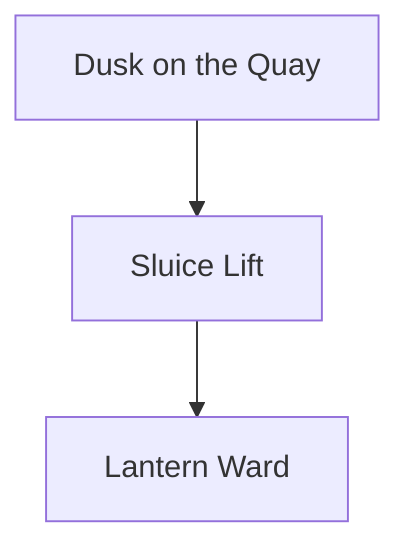

<!-- yllir
id: session-1
provenance: master
depends_on: []
location: [salt-harbor]
generated: true
-->

> Generated file. Do not edit by hand: it is rebuilt from the files in Events/.

## Events

- [Dusk on the Quay](Events/Dusk%20on%20the%20Quay.md)
- [Sluice Lift](Events/Sluice%20Lift.md)
- [Lantern Ward](Events/Lantern%20Ward.md)

## Entry points

- Dusk on the Quay

## Exits

- Lantern Ward
