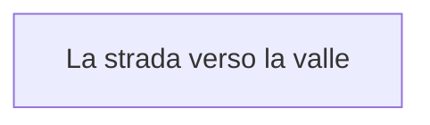

> Generated file. Do not edit by hand: it is rebuilt from the files in Eventi/.

## Events

- [La strada verso la valle](Eventi/La%20strada%20verso%20la%20valle.md)

## Entry points

- La strada verso la valle

## Exits

- La strada verso la valle
