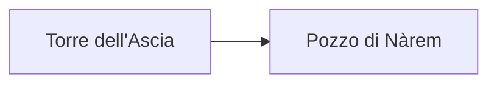

_Il vento porta la cenere dal Pozzo di Nàrem fino alle finestre._

Il gruppo incontra Teodo Marr davanti alla porta della locanda.

Mastro Teodo offre una stanza per la notte.

La locanda è piena di gente che parla a voce bassa, e il fumo dei camini si mescola alla cenere grigia.

### Controllo di osservazione (difficoltà da definire)
- **Successo:** il gruppo nota un uomo che sorveglia il molo.
- **Fallimento:** il gruppo entra nella locanda senza accorgersi di nulla.

_Dentro la sala il fuoco è basso e le travi scricchiolano._

Una donna dietro il banco pulisce lo stesso bicchiere da molto tempo, senza mai guardare la porta.

Il gruppo sale al piano di sopra, dove un corridoio stretto porta a sei camere chiuse.

## Il corridoio dei sussurri

Dalla porta in fondo arriva un sussurro che ripete sempre la stessa parola.

### Prova di ascolto (difficoltà da definire)
- **Successo:** il gruppo capisce che il sussurro viene da un tubo di argilla.
- **Fallimento:** il sussurro si interrompe e nessuno capisce da dove venga.

Chi ascolta a lungo sente un ritmo, come di passi lontani.

```
Nota: se il gruppo tarda, Sibilla Aurne parte da sola.
```

Il gruppo scende e trova il vecchio fuori dalla cucina, che mescola una zuppa grigia.

## Il prezzo di Fosco il Ramaio

Il fabbro vuole essere pagato prima di parlare, e ripete il prezzo tre volte.

### Trattativa (difficoltà da definire)
- **Successo:** il fabbro abbassa il prezzo di una moneta.
- **Fallimento:** il fabbro chiede il doppio e chiude la bottega.

Il gruppo esce dalla bottega con meno monete e con una mappa di strade.

Al mercato qualcuno giura di aver visto Teodo Marr correre verso il lago.

> Potete chiedere a Teodo Marr la strada per il Lago Grigio.

## Il registro del porto

Nel registro del porto le ultime righe sono scritte con una mano nervosa e veloce.

``Nel registro compare la firma `Lino Valdes`, scritta di fretta.``

Il gruppo confronta la grafia con quella di una lettera trovata in cucina.

<!-- ricordare: Lino Valdes non sa ancora nulla -->

Sibilla Aurne parla a nome della Voce del Pozzo.

Una pista porta al Pozzo di Narem.

Il gruppo trova la Lanterna di Morvalle sul tavolo.

Il vento entra dalla finestra e fa tremare le carte.

Oria chiede notizie del fratello scomparso.

La Torre dell'Ascia si vede dal sentiero.

| Chi | Dove |
| --- | --- |
| Oria Brunel | Lago Grigio |



Il sentiero sale tra rocce nere, e il vento non si ferma mai.

[Oria Valdes](../../../Personaggi/Oria%20Valdes.md) li aspetta al molo.

[Sibilla Aurne](../../../Personaggi/Teodo%20Marr.md) recita la preghiera della sera.

Sul molo le barche oscillano piano e nessuno parla.

Il gruppo chiede al pescatore più anziano dove si trovi la barca mancante.

Lui indica il lago, poi scuote la testa.

Prima dell'alba Teodo Marr chiude la locanda e sparisce.

Il gruppo si sveglia con la cenere sul davanzale e con una nuova domanda in testa.

_La luce grigia entra nella stanza come una lama sottile._

Il gruppo esce nel corridoio, dove il pavimento è coperto di impronte bagnate che scendono verso la cucina.

Scendendo le scale, il gruppo sente un rumore di catene dal cortile.

Fuori, nel cortile, la porta della stalla è aperta.

La sessione finisce qui, con il gruppo davanti alla porta socchiusa.
