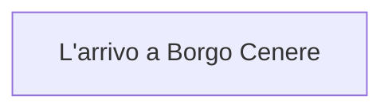

> Generated file. Do not edit by hand: it is rebuilt from the files in Eventi/.

## Events

- [L'arrivo a Borgo Cenere](Eventi/L'arrivo%20a%20Borgo%20Cenere.md)

## Entry points

- L'arrivo a Borgo Cenere

## Exits

- L'arrivo a Borgo Cenere
