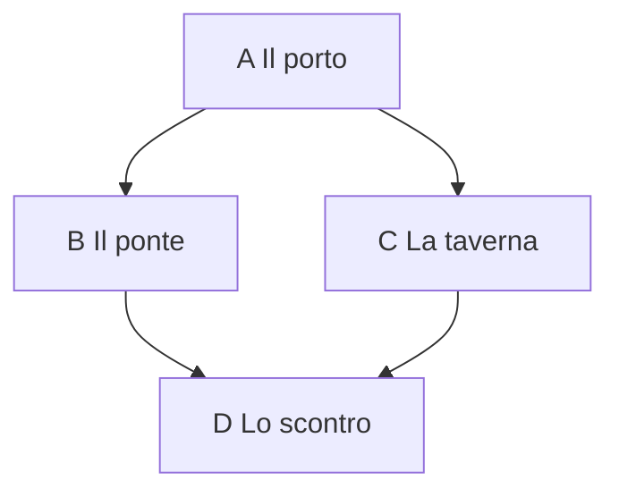

<!-- yllir
id: missione-1
depends_on: []
provenance: master
location: [porto-salso]
arc: "La compagnia del Corvo"
generated: true
-->

> Generated file. Do not edit by hand: it is rebuilt from the files in Eventi/.

## Events

- [A Il porto](Eventi/A%20Il%20porto.md)
- [B Il ponte](Eventi/B%20Il%20ponte.md)
- [C La taverna](Eventi/C%20La%20taverna.md)
- [D Lo scontro](Eventi/D%20Lo%20scontro.md)

## Entry points

- A Il porto

## Exits

- D Lo scontro
