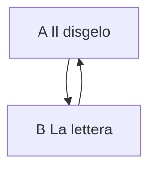

<!-- yllir
id: brenna-capitolo-4
depends_on: [brenna-capitolo-3]
provenance: master
location: [passo-del-corvo]
arc: "Le stagioni di Brenna"
generated: true
-->

> Generated file. Do not edit by hand: it is rebuilt from the files in Eventi/.

## Events

- [A Il disgelo](Eventi/A%20Il%20disgelo.md)
- [B La lettera](Eventi/B%20La%20lettera.md)

## Entry points

- none

## Exits

- none
